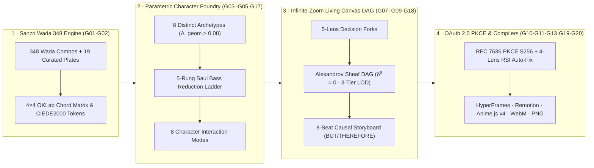

# CETI Motion Atlas Studio Pro (`v4.0.0`)

**Transcendental Motion Graphic & Narrative Design Studio**  
*Sanzo Wada 348 Harmonic Pinning · 8 Parametric Character Archetypes · Saul Bass 5-Rung Reduction Ladder · Infinite-Zoom Living Canvas Sheaf DAG · RFC 7636 OAuth 2.0 PKCE Live Storyboard Enhancer · Single-Clock Multi-Target Production Compiler*

[](#6-20-gate-mechanical-contract-scorecard--negative-mutation-selftest)
[](#6-20-gate-mechanical-contract-scorecard--negative-mutation-selftest)
[](#4-sanzo-wada-348-harmonic-color-closure)
[](#5-live-oauth-20-pkce-storyboard--character-enhancer)

---

## 1. Overview & Design Lineage

**CETI Motion Atlas Studio Pro** elevates the original *Motion Atlas Explorer* (`whale.html`) into a complete, contract-governed internal motion graphic and narrative design studio inspired by:

- **Orpheum / GEOME Transcendental Art Engine**: Full **348 Sanzo Wada (*Haishoku Soukan*, 1933)** harmonic color dictionary with live $4\times 4$ **OKLab** perceptual chord matrices, **CIEDE2000** ($\Delta E_{00}$) nearest CETI design token matching, and **WCAG AAA** ($\ge 7.0:1$) ink-on-paper contrast enforcement.
- **Saul Bass Graphic Reduction &Milton Glaser Ceremonial Overshoot**: Every character rig is defined across a **5-Rung Reduction Ladder** (`Rung 1 Full Narrative` $\to$ `Rung 5 Single-Stroke Gesture`) and verified against the **4-Test Emblem Gauntlet** (`16px Favicon`, `Silhouette`, `One-Move`, `Cut-Out`).
- **Alexandrov Sheaf Topology on an Infinite-Zoom Living Canvas**: Non-destructive creative branching (`0.15×` to `4.0×` semantic zoom) where every DAG node carries a canonical FNV-1a 32-bit restriction hash ($\rho(\text{child}) = \text{parent}$, $\delta^0 = 0$) and explicit conjecture annotations (`†C`).
- **RFC 7636 OAuth 2.0 PKCE (`S256`) Live Storyboard Enhancer**: Authenticate via PKCE or connect to the local agent loopback bridge (`http://127.0.0.1:43110`) to enhance 8-beat storyboards, fork 3 orthogonal directions ($\alpha/\beta/\gamma$), synthesize new custom character rigs, and run 4-lens adversarial RSI critiques live.

---

## 2. Package Structure & Master Files

Everything needed to run, inspect, validate, and extend the studio is organized cleanly in this repository:

```text
ceti-motion-atlas-studio-pro/
├── README.md                                          # Repository overview, quickstart & architecture
├── package.json                                       # NPM package scripts (start, build, validate, selftest)
├── STATUS.md                                          # Current v4.0.0 lock-in status & deliverable manifest
├── HANDOFF.md                                         # Cold-resume architecture guide & extension playbook
│
├── Motion Atlas Studio Pro — Standalone.html          # ★ Zero-dependency single-file studio bundle (432 KB)
├── Motion Atlas Studio Pro.dc.html                    # Modular studio HTML shell
├── index.html                                         # HTTP server entry HTML
├── geome-wada.js                                      # Complete 348 Sanzo Wada harmonic dictionary
├── studio-motion-engine.js                            # Wada OKLab/CIEDE2000 + 8 Archetypes + 8 Feels + MA.draw
├── studio-canvas-oauth.js                             # Living Canvas Sheaf DAG + OAuth 2.0 PKCE + Compilers + RSI
├── studio-ui.js                                       # 7 Interactive Studio Surfaces + Modals + MediaRecorder
│
├── dist/                                              # Compiled release artifacts
│   ├── ceti-motion-atlas-studio-pro.standalone.html   # Single-file standalone HTML build
│   ├── ceti-motion-atlas-master-dossier.md            # ★ Unified single-file master spec, build & RSI dossier
│   └── ...                                            # Modular HTML/JS release copies
│
├── docs/                                              # Formal Specifications & Adversarial RSI Ledgers
│   ├── MASTER-PACKAGE-DOSSIER.md                      # ★ All specs, contracts, RSI ledgers & handoff in ONE file
│   ├── TYPED-CONTRACT-MOTION-ATLAS.md                 # Formal TypeScript/JSON-Schema domain contracts (G01–G16)
│   ├── META-PLAN-AND-RSI.md                           # Operadic decomposition, sheaf topology & RSI critique loops
│   ├── RSI-LEDGER.md                                  # 4-Round Adversarial MOE audit log (v1 → v4) & selftests
│   └── FINDINGS-MOTION-ATLAS-STUDIO.md                # Durable architectural QC findings
│
├── scripts/                                           # Build, Validation & OAuth 2.0 Loopback Tooling
│   ├── build-package.mjs                              # Deterministic compiler for dist/ and master dossier
│   ├── validate-motion-studio.mjs                     # 20-Gate Mechanical Contract Validator + --selftest
│   └── oauth-bridge-server.mjs                        # Local HTTP Studio Server + OAuth 2.0 PKCE S256 Bridge
│
└── source_bundle/                                     # Original baseline reference (whale.html lineage)
    └── Motion Atlas Explorer.dc.html
```

---

## 3. Quick Start

### Option A · Zero-Install Single-File Studio
Open [`Motion Atlas Studio Pro — Standalone.html`](./Motion%20Atlas%20Studio%20Pro%20%E2%80%94%20Standalone.html) (or [`dist/ceti-motion-atlas-studio-pro.standalone.html`](./dist/ceti-motion-atlas-studio-pro.standalone.html)) directly in any modern browser. All 348 Sanzo Wada combinations, 8 character rigs, 15 motion styles, 8 storylines, 24 elements, and the deterministic Algebraic Synthesizer work 100% offline.

### Option B · Local Studio + OAuth 2.0 PKCE Loopback Server
```bash
npm start
# Starts http://127.0.0.1:43110/ with live RFC 7636 PKCE S256 handshake & /oauth/enhance endpoints
```

### Option C · Run the 20-Gate Mechanical Validator & 5-Test Negative Mutation Selftest
```bash
npm test
# Runs: node scripts/validate-motion-studio.mjs --selftest
```

### Option D · Rebuild Standalone Bundles & Unified Master Dossier
```bash
npm run build
# Runs: node scripts/build-package.mjs
```

---

## 4. System Architecture & 8 Parametric Character Archetypes



### The 8 Built-In Parametric Character Rigs (`Zero Hardcoded Whale Lock-In`)

| ID | Name | Archetype | Anatomical Signature (`actorGeom` + `renderActor`) | Default Wada Plate |
|---|---|---|---|---|
| `ceti-whale` | **Pelagic Sovereign** | `cetacean` | Arched rostrum, pleated ventral throat grooves, crescent tail flukes | No. 343 · *Abyssal Indigo & Raw Umber* |
| `saul-falcon` | **Peregrine Cut** | `avian` | Hooked raptor beak, swept primary wings, fanned tail feathers, sharp sternum keel | No. 126 · *Vermilion Cut & Bone Black* |
| `lantern-bathysphere` | **Trench Lantern** | `submersible` | Spherical pressure hull, circular quartz viewport & rivets, ventral landing skid | No. 166 · *Bathyal Amber & Prussian* |
| `origami-crane` | **Origami Tsuru** | `geometric` | Narrow folded neck/beak, wide triangular delta wings, internal valley-fold crease lines | No. 48 · *Shoji Cream & Sumi Ink* |
| `astronav-compass` | **Pelagic Astrolabe** | `instrument` | Concentric brass gimbal rings, cardinal lug ears, degree ticks, 4-point compass star | No. 296 · *Chartreuse Bearing & Slate* |
| `nib-scriptor` | **Sumi Nib** | `calligraphic` | Tapered metallic shoulders, razor nib point, capillary ink slit, central circular breather hole | No. 14 · *Sepia Walnut & Parchment* |
| `geome-orpheus` | **Orpheum Lyre-Sphere** | `mythic` | 8-fold $D_8$ rose-lyre harmonic mandala, inscribed octagon, 5 vertical golden lyre strings | No. 219 · *Orphic Gold & Lapis* |
| `kelp-leviathan` | **Pelagic Riff-Serpent** | `botanical` | 5-wave undulating botanical frond lobes, serrated kelp blades, central midrib vein & gas bladders | No. 92 · *Tidal Kelp & Ochre* |

---

## 5. Live OAuth 2.0 PKCE Storyboard & Character Enhancer

The studio implements **RFC 7636 OAuth 2.0 Proof Key for Code Exchange (`S256`)** across 4 provider modes:
1. **Local Loopback Bridge (`http://127.0.0.1:43110`) + PKCE** (`scripts/oauth-bridge-server.mjs`)
2. **OpenRouter OAuth 2.0 PKCE (`S256`)**
3. **Google OAuth 2.0 PKCE (GIS)**
4. **Offline Deterministic Algebraic Synthesizer** (zero-network fallback)

Every enhancement response is verified by **Gate `G11` (`CO.validateEnhancementResponse`)** before touching the canvas or storyboard.

---

## 6. 20-Gate Mechanical Contract Scorecard & Negative Mutation Selftest

Run `npm test` (`node scripts/validate-motion-studio.mjs --selftest`) to verify all 20 gates and 5 negative mutations:

- **`G01–G02`**: `348` Sanzo Wada combinations + `19` curated plates + $4\times 4$ OKLab matrix + CIEDE2000 tokens + WCAG AAA contrast (`min = 7.65:1`).
- **`G03–G06`**: `8` characters $\times$ `6` render modes (`48/48`), `5` Saul Bass reduction rungs (`40/40`), `8` interaction modes (`64/64`), `15` styles + `8` storylines on a single deterministic clock `window.MA.draw`.
- **`G07–G09`**: `5` decision fork lenses, `8/8` causal storyboards (`BUT`/`THEREFORE`), Infinite-Zoom Living Canvas (`0.15×–4.0×` 3-tier LOD).
- **`G10–G16`**: OAuth 2.0 PKCE (`S256`), schema guard, 100% offline 171-node corpus, Multi-Target Compiler, `.motion.studio.json` round-trip, CETI editorial typography, keyboard shortcuts (`Space`, `[`, `]`, `C`, `F`), and `prefers-reduced-motion`.
- **`G17`**: `tell-apart` Archetype Discriminability Kernel (`28/28` pairs distinct, $\min \Delta_{\text{geom}} = 0.1906 > 0.08$) + `8` timing feels (including `rostrum`).
- **`G18`**: Alexandrov Sheaf Restriction Cohomology ($\delta^0 = 0$ across all DAG edges after 3-direction $\alpha/\beta/\gamma$ fork).
- **`G19`**: 4-Lens Adversarial RSI Critique & Surgical Auto-Fix (`A1 Saul Bass`, `A2 Koolhaas`, `A3 Hydrography`, `A4 HyperFrames Sheaf`).
- **`G20`**: Extended Compilers (`Anime.js v4` timeline + `Playable Single-Clock HTML5` + `WebM` video `MediaRecorder`).
- **`MUT-01` – `MUT-05` (`--selftest`)**: Proves synthetic mutations (low contrast, cloned character geometry, corrupted `upstreamHash`, forbidden `"AND THEN"` hinge, malformed OAuth JSON) are 100% caught.
