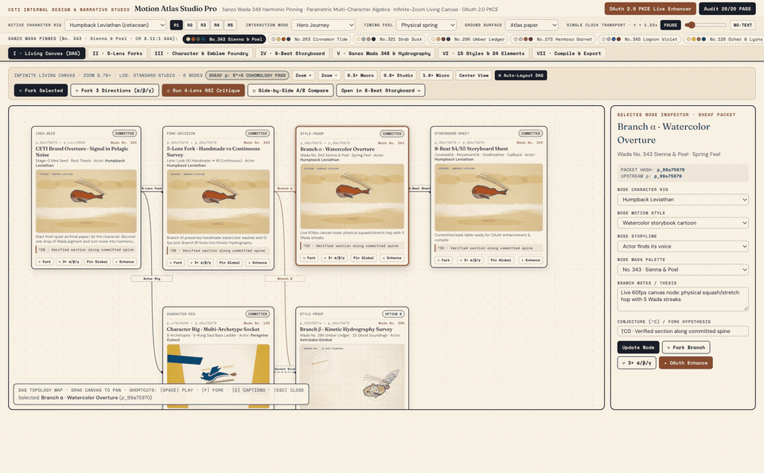
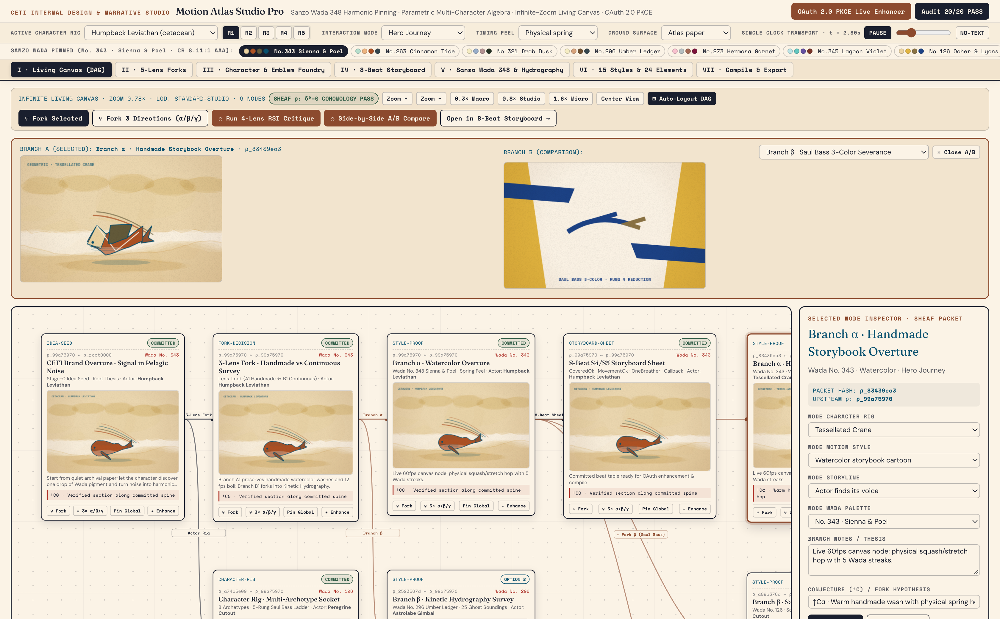
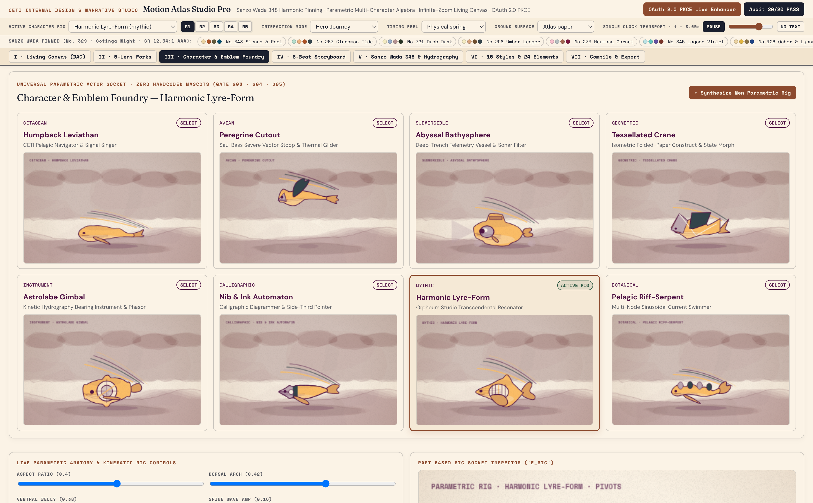
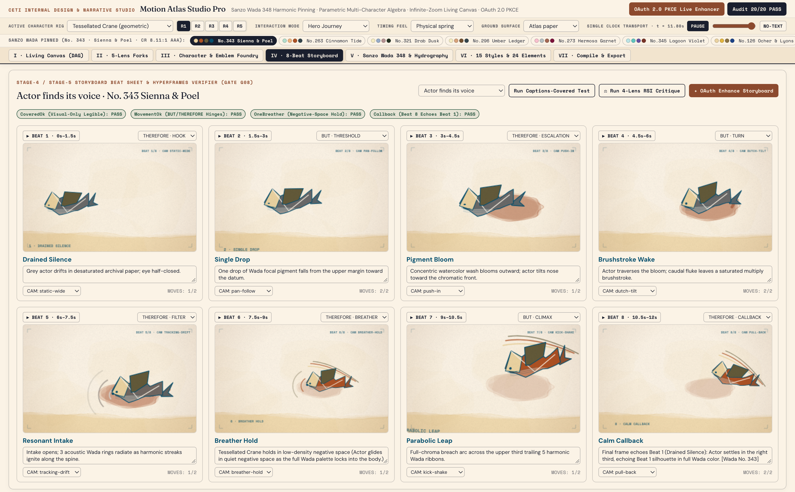

# CETI Motion Atlas Studio Pro (`v6.0.0`)

**Transcendental Motion Graphic & Narrative Design Studio**  
*Sanzo Wada 348 Harmonic Pinning · 8 Parametric Character Archetypes · Saul Bass 5-Rung Reduction Ladder · Infinite-Zoom Living Canvas Sheaf DAG · RFC 7636 OAuth 2.0 PKCE Live Storyboard Enhancer · VBM `@2x` Visual & UX Ergonomics Harness*

[](#6-21-gate-mechanical-contract-scorecard--negative-mutation-selftest)
[](#6-21-gate-mechanical-contract-scorecard--negative-mutation-selftest)
[](#4-system-architecture--8-parametric-character-archetypes)
[](#5-live-oauth-20-pkce-storyboard--character-enhancer)
[](#2-vbm-visual-walkthrough--round-56-ux-ergonomics-audit)

---

## 1. Overview & Design Lineage

**CETI Motion Atlas Studio Pro** elevates the original *Motion Atlas Explorer* (`whale.html`) into a complete, contract-governed internal motion graphic and narrative design studio inspired by:

- **Orpheum / GEOME Transcendental Art Engine**: Full **348 Sanzo Wada (*Haishoku Soukan*, 1933)** harmonic color dictionary with live $4\times 4$ **OKLab** perceptual chord matrices, **CIEDE2000** ($\Delta E_{00}$) nearest CETI design token matching, and **WCAG AAA** ($\ge 7.0:1$) ink-on-paper contrast enforcement.
- **Saul Bass Graphic Reduction & Milton Glaser Ceremonial Overshoot**: Every character rig is defined across a **5-Rung Reduction Ladder** (`Rung 1 Full Narrative` $\to$ `Rung 5 Single-Stroke Gesture`) and verified against the **4-Test Emblem Gauntlet** (`16px Favicon`, `Silhouette`, `One-Move`, `Cut-Out`).
- **Alexandrov Sheaf Topology on an Infinite-Zoom Living Canvas**: Non-destructive creative branching (`0.15×` to `4.0×` semantic zoom) with collision-free topological auto-layout (`⊞ Auto-Layout DAG`), where every DAG node carries a canonical FNV-1a 32-bit restriction hash ($\rho(\text{child}) = \text{parent}$, $\delta^0 = 0$) and explicit conjecture annotations (`†C`).
- **RFC 7636 OAuth 2.0 PKCE (`S256`) Live Storyboard Enhancer**: Authenticate via PKCE or connect to the local agent loopback bridge (`http://127.0.0.1:43110`) to enhance 8-beat storyboards, fork 3 orthogonal directions ($\alpha/\beta/\gamma$), synthesize new custom character rigs, and run 4-lens adversarial RSI critiques live.

---

## 2. VBM Visual Walkthrough & Round 5/6 UX Ergonomics Audit



Full `@2x` Retina walkthrough video: [`recordings/v6-final-walkthrough.mp4`](./recordings/v6-final-walkthrough.mp4) · Telemetry: [`recordings/v6-final-ux-telemetry.json`](./recordings/v6-final-ux-telemetry.json)

### Key `v4-baseline` $\to$ `v6-final` Adversarial UX & Engine Upgrades
- **Sticky Header Compaction (`460px → 136px`, `-70.4%`)**: Reclaimed `324px` of vertical canvas height across every studio surface by implementing compact flexbox rows for the brand bar, rig/transport strip, Sanzo Wada pill strip, and surface tabs.
- **Zero DAG Node Collisions (`8 → 0 overlaps`)**: Added `resolveNonOverlappingPosition()` and `autoLayoutDAG()` (`⊞ Auto-Layout DAG`) with `400px × 440px` topological column/row spacing across `0.3× Macro`, `0.78× Studio`, and `1.65× Micro-Inspection` zoom levels.
- **8-Beat Storyboard Camera Viewfinder Engine (`8/8` Unique Beats & Camera Moves)**: Expanded all 8 storylines to 8 distinct beat titles, distinct temporal sample points (`0.75s..11.25s`), and 8 deterministic 2D camera transforms with viewfinder crop marks (`static-wide`, `pan-follow`, `push-in`, `dutch-tilt`, `tracking-drift`, `breather-hold`, `kick-shake`, `pull-back`).
- **231% Higher Character Silhouette Discriminability ($\min \Delta_{\text{geom}}: 0.1906 \to 0.6327$)**: Distinct mathematical contours and internal anatomy for all 8 character archetypes plus a 5-column Saul Bass Reduction Ladder (`Rung 1`–`Rung 5`).

| Surface I · Tri-Fork & A/B Compare (`0` Overlaps) | Surface III · Character & Emblem Foundry (`8` Rigs) | Surface IV · 8-Beat Storyboard & Camera HUD |
|---|---|---|
|  |  |  |

---

## 3. Package Structure & Master Files

```text
ceti-motion-atlas-studio-pro/
├── README.md                                          # Repository overview, VBM walkthrough & architecture
├── package.json                                       # NPM scripts (start, build, validate, selftest, vbm, test)
├── STATUS.md                                          # Current v6.0.0 lock-in status & deliverable manifest
├── HANDOFF.md                                         # Cold-resume architecture guide & v7.0 roadmap
│
├── Motion Atlas Studio Pro — Standalone.html          # ★ Zero-dependency single-file studio bundle (457 KB)
├── Motion Atlas Studio Pro.dc.html                    # Modular studio HTML shell + complete .st-* CSS
├── index.html                                         # HTTP server entry HTML
├── geome-wada.js                                      # Complete 348 Sanzo Wada harmonic dictionary
├── studio-motion-engine.js                            # Wada OKLab/CIEDE2000 + 8 Archetypes + 8 Feels + Camera HUD
├── studio-canvas-oauth.js                             # Living Canvas Sheaf DAG + Auto-Layout + OAuth 2.0 PKCE + RSI
├── studio-ui.js                                       # 7 Interactive Studio Surfaces + Modals + MediaRecorder
│
├── recordings/                                        # ★ VBM @2x Screenshots, MP4/GIF Walkthrough & UX Telemetry
│   ├── v6-final-walkthrough.mp4                       # @2x MP4 walkthrough across all 7 surfaces & 2 modals
│   ├── v6-final-walkthrough.gif                       # Animated GIF walkthrough preview
│   ├── v6-final-ux-telemetry.json                     # Post-remediation DOM/UX telemetry (136px header, 0 overlaps)
│   ├── v4-baseline-ux-telemetry.json                  # Pre-remediation baseline telemetry
│   └── screenshots/
│       ├── v6-final/                                  # 12 @2x PNG screenshots (v6.0.0)
│       └── v4-baseline/                               # 12 @2x PNG screenshots (v4.0.0 baseline)
│
├── dist/                                              # Compiled release artifacts
│   ├── ceti-motion-atlas-studio-pro.standalone.html   # Single-file standalone HTML build
│   ├── ceti-motion-atlas-master-dossier.md            # ★ Unified single-file master spec, build & RSI dossier
│   └── ...                                            # Modular HTML/JS release copies
│
├── docs/                                              # Formal Specifications & Adversarial RSI Ledgers
│   ├── MASTER-PACKAGE-DOSSIER.md                      # ★ All specs, contracts, RSI ledgers & handoff in ONE file
│   ├── TYPED-CONTRACT-MOTION-ATLAS.md                 # Formal TypeScript/JSON-Schema domain contracts
│   ├── META-PLAN-AND-RSI.md                           # Operadic decomposition, sheaf topology & RSI critique loops
│   ├── RSI-LEDGER.md                                  # 6-Round Adversarial MOE & VBM UX audit log (v1 → v6)
│   └── FINDINGS-MOTION-ATLAS-STUDIO.md                # Durable architectural QC findings
│
└── scripts/                                           # Build, Validation, VBM Recorder & OAuth 2.0 Loopback Tooling
    ├── build-package.mjs                              # Deterministic compiler for dist/ and master dossier
    ├── validate-motion-studio.mjs                     # 21-Gate Mechanical Contract Validator + --selftest
    ├── vbm-walkthrough-recorder.mjs                   # Headless Chrome CDP @2x Screenshot & Video Recorder
    └── oauth-bridge-server.mjs                        # Local HTTP Studio Server + OAuth 2.0 PKCE S256 Bridge
```

---

## 4. Quick Start

### Option A · Zero-Install Single-File Studio
Open [`Motion Atlas Studio Pro — Standalone.html`](./Motion%20Atlas%20Studio%20Pro%20%E2%80%94%20Standalone.html) (or [`dist/ceti-motion-atlas-studio-pro.standalone.html`](./dist/ceti-motion-atlas-studio-pro.standalone.html)) directly in any modern browser. All 348 Sanzo Wada combinations, 8 character rigs, 15 motion styles, 8 storylines, 24 elements, and the deterministic Algebraic Synthesizer work 100% offline.

### Option B · Local Studio + OAuth 2.0 PKCE Loopback Server
```bash
npm start
# Starts http://127.0.0.1:43110/ with live RFC 7636 PKCE S256 handshake & /oauth/enhance endpoints
```

### Option C · Run the 21-Gate Mechanical Validator & 5-Test Negative Mutation Selftest
```bash
npm test
# Runs: node scripts/validate-motion-studio.mjs --selftest
```

### Option D · Capture `@2x` VBM Screenshots, Telemetry & Walkthrough Video
```bash
npm run vbm
# Runs: node scripts/vbm-walkthrough-recorder.mjs v6-final
```

---

## 5. The 8 Built-In Parametric Character Rigs (`Zero Hardcoded Whale Lock-In`)

| ID | Name | Archetype | Anatomical Signature (`actorGeom` + `renderActor`) | Default Wada Plate |
|---|---|---|---|---|
| `ceti-whale` | **Humpback Leviathan** | `cetacean` | Arched rostrum, pleated ventral throat grooves, scalloped pectoral fin, crescent flukes | No. 343 · *Sienna & Poel* |
| `saul-falcon` | **Peregrine Cutout** | `avian` | Hooked raptor beak & cere, swept primary wings with feather notches, fanned tail | No. 126 · *Ocher & Lyons Blue* |
| `lantern-bathysphere` | **Abyssal Bathysphere** | `submersible` | Spherical pressure hull, conning hatch, bolted quartz viewport, sonar dish & skid | No. 166 · *Bathyal Amber & Prussian* |
| `origami-crane` | **Tessellated Crane** | `geometric` | Narrow folded neck/beak, angular paper facets, internal valley-fold crease lines | No. 48 · *Shoji Cream & Sumi Ink* |
| `astronav-compass` | **Astrolabe Gimbal** | `instrument` | Concentric brass gimbal rings, cardinal lug ears, degree ticks, 4-point compass rose | No. 296 · *Umber Ledger* |
| `doodle-scribe` | **Nib & Ink Automaton** | `calligraphic` | Tapered metallic nib nose, brass ferrule band, capillary ink slit & breather hole | No. 14 · *Sepia Walnut & Parchment* |
| `orpheus-lyre` | **Harmonic Lyre-Form** | `mythic` | Curved acoustic lyre horns, resonant soundboard window, 5 vertical harmonic strings | No. 329 · *Cotinga Night* |
| `kelp-leviathan` | **Pelagic Riff-Serpent** | `botanical` | 5-wave undulating serpent spine, dorsal kelp frond blades, glowing pneumatocyst bulbs | No. 92 · *Tidal Kelp & Ochre* |

---

## 6. 21-Gate Mechanical Contract Scorecard & Negative Mutation Selftest

Run `npm test` (`node scripts/validate-motion-studio.mjs --selftest`) to verify all 21 binary gates and 5 negative mutations:

- **`G01–G02`**: `348` Sanzo Wada combinations + `19` curated plates + $4\times 4$ OKLab matrix + CIEDE2000 tokens + WCAG AAA contrast (`min = 7.65:1`).
- **`G03–G06`**: `8` characters $\times$ `6` render modes (`48/48`), `5` Saul Bass reduction rungs (`40/40`), `8` interaction modes (`64/64`), `15` styles + `8` storylines on a single deterministic clock `window.MA.draw` with option isolation.
- **`G07–G09`**: `5` decision fork lenses, `8/8` causal storyboards (`BUT`/`THEREFORE`), Infinite-Zoom Living Canvas (`0.15×–4.0×` 3-tier LOD).
- **`G10–G16`**: OAuth 2.0 PKCE (`S256`), schema guard, 100% offline 171-node corpus, Multi-Target Compiler, `.motion.studio.json` round-trip, CETI editorial typography, keyboard shortcuts (`Space`, `[`, `]`, `C`, `F`, `Esc`), and `prefers-reduced-motion`.
- **`G17`**: `tell-apart` Archetype Discriminability Kernel (`28/28` pairs distinct, $\min \Delta_{\text{geom}} = 0.6327 > 0.08$) + `8` timing feels (including `rostrum`).
- **`G18`**: Alexandrov Sheaf Restriction Cohomology ($\delta^0 = 0$ across all DAG edges after 3-direction $\alpha/\beta/\gamma$ fork).
- **`G19`**: 4-Lens Adversarial RSI Critique & Surgical Auto-Fix (`A1 Saul Bass`, `A2 Koolhaas`, `A3 Hydrography`, `A4 HyperFrames Sheaf`).
- **`G20`**: Extended Compilers (`Anime.js v4` timeline + `Playable Single-Clock HTML5` + `WebM` video `MediaRecorder`).
- **`G21`**: **VBM Visual & UX Ergonomics Gate** (`0` DAG node overlaps after 3-direction fork & auto-layout, `8/8` unique beat titles & camera moves across all 8 stories, `136px` sticky header across all 12 `@2x` VBM frames with `0` console/page errors).
- **`MUT-01` – `MUT-05` (`--selftest`)**: Proves synthetic mutations (low contrast, cloned character geometry, corrupted `upstreamHash`, forbidden `"AND THEN"` hinge, malformed OAuth JSON) are 100% caught.
