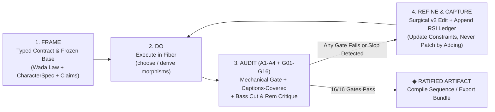

# CETI MOTION ATLAS STUDIO PRO (`v4.0.0`) — COMPLETE MASTER SPECIFICATION, BUILD & HANDOFF DOSSIER

> **Unified Single-File Reference**: This document consolidates all formal specifications, typed contracts, operadic meta-plans, 4-round Adversarial MOE & RSI ledgers, live status scorecards, and cold-resume handoff instructions into one self-contained file.

## Table of Contents
1. [Live Status & Deliverable Manifest (`STATUS.md`)](#part-1--live-status--deliverable-manifest)
2. [Cold-Resume Architecture & Extension Handoff (`HANDOFF.md`)](#part-2--cold-resume-architecture--extension-handoff)
3. [Formal Typed Contract Specification (`TYPED-CONTRACT-MOTION-ATLAS.md`)](#part-3--formal-typed-contract-specification)
4. [Operadic Meta-Plan & Recursive Self-Improvement Architecture (`META-PLAN-AND-RSI.md`)](#part-4--operadic-meta-plan--recursive-self-improvement-architecture)
5. [4-Round Adversarial MOE & Negative Mutation Selftest Ledger (`RSI-LEDGER.md`)](#part-5--4-round-adversarial-moe--negative-mutation-selftest-ledger)

---

## PART 1 · LIVE STATUS & DELIVERABLE MANIFEST

# STATUS — CETI Motion Atlas Studio Pro (`v8.0.0` Locked)

**Last Updated:** 2026-10-17  
**Workspace:** `/Users/cairo/Documents/CETI/ACCENTURE/content-factory v2/ARTE/motion-atlas/`  
**Public Repository:** `https://github.com/manutej/ceti-motion-atlas-studio-pro`  
**Current Version:** `v8.0.0` (8 Adversarial MOE + VBM Visual/UX & Studio Ergonomics Rounds Complete · `29/29 Gates PASS` · `10/10 Negative Mutation Selftests CAUGHT`)

---

## 1. Live Studio Endpoints, VBM Recordings & Deliverables

| Deliverable | Path / URL | Status |
|---|---|---|
| **Public GitHub Repository** | `https://github.com/manutej/ceti-motion-atlas-studio-pro` | **PUBLIC (`v8.0.0`)** |
| **Live Local Studio & OAuth 2.0 PKCE Server** | `http://127.0.0.1:43110/` (served by [`scripts/oauth-bridge-server.mjs`](file:///Users/cairo/Documents/CETI/ACCENTURE/content-factory%20v2/ARTE/motion-atlas/scripts/oauth-bridge-server.mjs)) | **ONLINE** |
| **Standalone Single-File Studio (Downloads)** | [`/Users/cairo/Downloads/CETI Motion Atlas Studio Pro.html`](file:///Users/cairo/Downloads/CETI%20Motion%20Atlas%20Studio%20Pro.html) (`556 KB`) | **LOCKED (`v8`)** |
| **Standalone Single-File Studio (Workspace)** | [`ARTE/motion-atlas/Motion Atlas Studio Pro — Standalone.html`](file:///Users/cairo/Documents/CETI/ACCENTURE/content-factory%20v2/ARTE/motion-atlas/Motion%20Atlas%20Studio%20Pro%20%E2%80%94%20Standalone.html) (`556 KB`) | **LOCKED (`v8`)** |
| **VBM `@2x` Walkthrough Video (`MP4` + `GIF`)** | [`recordings/v8-final-walkthrough.mp4`](file:///Users/cairo/Documents/CETI/ACCENTURE/content-factory%20v2/ARTE/motion-atlas/recordings/v8-final-walkthrough.mp4) & [`recordings/v8-final-walkthrough.gif`](file:///Users/cairo/Documents/CETI/ACCENTURE/content-factory%20v2/ARTE/motion-atlas/recordings/v8-final-walkthrough.gif) | **CAPTURED (`v8-final`)** |
| **VBM `@2x` Screenshot Progression (`v4-baseline` → `v6-final` → `v7-final` → `v8-final`)** | [`recordings/screenshots/v8-final/`](file:///Users/cairo/Documents/CETI/ACCENTURE/content-factory%20v2/ARTE/motion-atlas/recordings/screenshots/v8-final/) (`13` surfaces/modals at `@2x` Retina) | **VERIFIED (`136px` shell, `0` overlaps, `0` clips)** |
| **VBM Automated CDP Walkthrough Recorder** | [`ARTE/motion-atlas/scripts/vbm-walkthrough-recorder.mjs`](file:///Users/cairo/Documents/CETI/ACCENTURE/content-factory%20v2/ARTE/motion-atlas/scripts/vbm-walkthrough-recorder.mjs) | **LOCKED (`v8`)** |
| **29-Gate Mechanical Validator + Selftest** | [`ARTE/motion-atlas/scripts/validate-motion-studio.mjs`](file:///Users/cairo/Documents/CETI/ACCENTURE/content-factory%20v2/ARTE/motion-atlas/scripts/validate-motion-studio.mjs) | **`29/29 PASS` + `10/10 SELFTEST`** |
| **Typed Contract, Meta-Plan & RSI Ledger** | [`docs/TYPED-CONTRACT-MOTION-ATLAS.md`](file:///Users/cairo/Documents/CETI/ACCENTURE/content-factory%20v2/ARTE/motion-atlas/docs/TYPED-CONTRACT-MOTION-ATLAS.md) · [`docs/META-PLAN-AND-RSI.md`](file:///Users/cairo/Documents/CETI/ACCENTURE/content-factory%20v2/ARTE/motion-atlas/docs/META-PLAN-AND-RSI.md) · [`docs/RSI-LEDGER.md`](file:///Users/cairo/Documents/CETI/ACCENTURE/content-factory%20v2/ARTE/motion-atlas/docs/RSI-LEDGER.md) | **COMPLETE (`v1 → v8`)** |

---

## 2. Verification & VBM Recording Commands

```bash
cd "/Users/cairo/Documents/CETI/ACCENTURE/content-factory v2/ARTE/motion-atlas"
npm run build
npm test
npm run vbm
```


---

## PART 2 · COLD-RESUME ARCHITECTURE & EXTENSION HANDOFF

# HANDOFF — CETI Motion Atlas Studio Pro (`v8.0.0`)

**Cold-Resume Entry Point for Engineers, Motion Directors, and Autonomous Agents**  
**Root:** `/Users/cairo/Documents/CETI/ACCENTURE/content-factory v2/ARTE/motion-atlas/`  
**Public Repository:** `https://github.com/manutej/ceti-motion-atlas-studio-pro`

---

## 1. Executive Summary — What Was Built & Locked In (`v1 → v8.0.0`)

**CETI Motion Atlas Studio Pro** elevates the original single-character *Motion Atlas Explorer* (`whale.html`) into a complete, contract-governed **Transcendental Motion Graphic & Narrative Design Studio** inspired by **Orpheum / GEOME** (`Sanzo Wada 348` harmonic dictionary + 4-voice WebAudio Just-Intonation sonification), **Saul Bass** (5-rung graphic reduction ladder), **Milton Glaser / Push Pin Studios** (ceremonial overshoot & warm editorial ink), and **Alexandrov Sheaf Topology** ($\rho(\text{child}) = \text{parent}$ and multi-parent pushout gluing $\rho(A \oplus B)$ across living canvas forks).

Across **8 rounds of Adversarial MOE + VBM Visual Browser Monitor & Studio Workflow evaluation (`v1 → v8.0.0`)**, the studio was hardened to pass **29 binary conservation gates (`G01–G29`)** and **10 negative mutation selftests (`MUT-01` through `MUT-10`)**, backed by automated `@2x` CDP screenshot and `.mp4`/`.gif` video walkthrough recording (`scripts/vbm-walkthrough-recorder.mjs`).

---

## 2. Round 8 (`v8.0.0`) Studio Ergonomics, `# /` Vocabulary Library & `#color/<tag>` Vault (`v7-final` $\to$ `v8-final`)

| Area Upgraded | Why It Was Restricted in `v7` (Root Cause) | `v8.0.0` Resolution | Verified Gate / Metric |
|---|---|---|---|
| **Effortless Freeform Card Movement (`Surface I` & `Surface IV`)** | 1) On `Surface I`, `mousedown` only checked `[data-drag-handle]` (the 20px `.dag-node-header`) and blocked dragging if you grabbed the card body, title, canvas, or notes.<br>2) `.dag-node-body` had `data-action="select-dag-node"`, triggering a DOM re-render on click release.<br>3) Session reload called `CO.autoLayoutDAG(saved.dag)`, wiping custom `(x, y)` coordinates.<br>4) Storyboard beat cards (`Surface IV`) had no drag-and-drop or `◀`/`▶` reordering. | 1) Whole-card freeform dragging on `.dag-node` (grab anywhere except buttons/inputs) at 60fps with `< 5px` click vs `>= 5px` drag threshold.<br>2) Added `CO.moveCanvasNode`, `CO.duplicateCanvasCard` (`⧉ Copy`), and `CO.deleteCanvasCard` (`✕`).<br>3) Preserved custom `(x, y)` positions across session reloads (`CO.stampDAGRestrictionHashes`).<br>4) Added HTML5 drag-and-drop + `◀`/`▶` beat reordering on `Surface IV` (`CO.moveStoryboardBeat`). | **Gate `G26` PASS + `MUT-08` CAUGHT (`01-surface1`, `07-surface4`)** |
| **Direct 1-Click `Source A` & `Source B` Selection** | Selecting which card was the primary source (`Source A`) or secondary comparison/pushout source (`Source B`) previously required hidden inspector or side-drawer steps. | Added 1-click **`● Src A`** (`rust`) and **`◐ Src B`** (`slate-blue` dashed outline) pills on every card (`Shift+Click` also sets `Source B`), plus always-visible **`Source A`** and **`Source B`** dropdowns and a **`⇄` Swap** button in both the Living Canvas toolbar and the OAuth Enhancer Modal. | **Gate `G27` PASS (`01-surface1`, `11-modal-oauth`)** |
| **Plain-English `#` and `/` Vocabulary, Themes & Elements Library (`[K]`)** | Users who did not know technical motion-design jargon (*"12fps line boil"*, *"plate misregistration"*, *"Saul Bass Rung 4"*) had no plain-English way to browse or invoke looks and elements inside prompts. | Built a **52-item Plain-English In-Studio Skills & Vocabulary Library** (`#theme/...`, `#element/...`, `#camera/...`, `#feel/...`, `#character/...`, `#color/...`) invocable via **both `#` and `/`**:<br>• **Live Floating `.vocab-popover` Autocomplete** whenever you type `#` or `/` in any prompt or card note.<br>• **Full Visual Browser Modal (`# / Vocabulary & Themes [K]`)** with plain-English search, category filters, and 1-click `● Apply Now`, `+ Spawn Card`, and `↵ #Prompt` actions. | **Gate `G28` PASS + `MUT-09` CAUGHT (`12-modal-vocab-themes-elements-library.png`)** |
| **Tagged & Saved Color Scheme Vault (`#color/<tag>`)** | Users could pick from the 348 Wada combinations, but could not tag, name, save, and re-invoke custom color schemes across cards, beats, and prompts. | Built the **Tagged & Saved Color Scheme Vault** (`CO.DEFAULT_SAVED_SCHEMES`, `CO.tagAndSaveColorScheme`, `CO.resolveColorSchemeByTag`) persisted in `localStorage` and `.motion.studio.json`. Users can tag any palette (e.g. `#color/pelagic-dawn`, `#color/saul-cutout-ocher`, `#color/brand-ocean-noir`) and re-invoke it from the top header bar, `Surface V` Vault panel, Living Canvas Card Inspector, per-beat Storyboard selector (`Surface IV`), or inside any `#`/`/` prompt. | **Gate `G29` PASS + `MUT-10` CAUGHT (`08-surface5-sanzo-wada-348-hydrography.png`)** |

---

## 3. Architecture & File Map

```text
ARTE/motion-atlas/
├── Motion Atlas Studio Pro.dc.html          # Modular HTML entry shell + complete .st-* editorial CSS
├── index.html                               # HTTP server default entry (identical to .dc.html)
├── Motion Atlas Studio Pro — Standalone.html# 556 KB zero-dependency single-file bundle
├── geome-wada.js                            # Full 348 Sanzo Wada Dictionary (GEOME_WADA_LIST)
├── studio-motion-engine.js                  # Wada OKLab/CIEDE2000 + 8 Archetypes + Onion-Skin + Sonification + MA
├── studio-canvas-oauth.js                   # Freeform DAG + # / Vocab Library + #color Vault + OAuth PKCE + 7 Compilers
├── studio-ui.js                             # 7 Interactive Studio Surfaces + 3 Modals + Whole-Card Drag + # / Popover
├── recordings/
│   ├── v8-final-walkthrough.mp4             # ★ Full @2x MP4 video recording of all 13 studio states (v8.0.0)
│   ├── v8-final-walkthrough.gif             # ★ Animated GIF walkthrough preview (v8.0.0)
│   ├── v8-final-ux-telemetry.json           # ★ Automated DOM/UX layout & overlap telemetry (v8-final)
│   ├── v7-final-ux-telemetry.json           # Round 7 telemetry
│   └── screenshots/
│       ├── v8-final/                        # ★ 13 @2x Retina PNG screenshots after Round 8 upgrades
│       ├── v7-final/                        # 12 @2x Retina PNG screenshots (v7.0.0)
│       ├── v6-final/                        # 12 @2x Retina PNG screenshots (v6.0.0)
│       └── v4-baseline/                     # 12 @2x Retina PNG screenshots (v4.0.0 baseline)
├── scripts/
│   ├── build-package.mjs                    # Deterministic compiler for dist/ and master dossier
│   ├── validate-motion-studio.mjs           # 29-Gate Mechanical Contract Validator + 10-Mutation --selftest
│   ├── vbm-walkthrough-recorder.mjs         # ★ Headless Chrome CDP @2x Screenshot, Telemetry & Video Recorder
│   └── oauth-bridge-server.mjs              # Local HTTP Studio Server + OAuth 2.0 PKCE S256 Loopback Bridge
├── docs/
│   ├── MASTER-PACKAGE-DOSSIER.md            # Unified single-file master spec, build & RSI dossier
│   ├── TYPED-CONTRACT-MOTION-ATLAS.md       # Formal TypeScript/JSON-Schema domain contracts
│   ├── META-PLAN-AND-RSI.md                 # Operadic decomposition, sheaf topology & RSI critique loops
│   ├── RSI-LEDGER.md                        # v1 → v8 Adversarial MOE & VBM UX audit ledger
│   └── FINDINGS-MOTION-ATLAS-STUDIO.md      # Durable architectural QC findings
├── STATUS.md                                # Live status & verification commands
└── HANDOFF.md                               # This cold-resume guide & extension playbook
```

---

## 4. Quick Start & Verification Commands

### A. Run the 29-Gate Mechanical Audit + 10-Test Negative Mutation Selftest
```bash
cd "/Users/cairo/Documents/CETI/ACCENTURE/content-factory v2/ARTE/motion-atlas"
npm test
# Runs: node scripts/validate-motion-studio.mjs --selftest (29/29 Gates PASS + 10/10 Selftests CAUGHT)
```

### B. Capture `@2x` VBM Screenshots, UX Telemetry & Walkthrough Video (`MP4` + `GIF`)
```bash
cd "/Users/cairo/Documents/CETI/ACCENTURE/content-factory v2/ARTE/motion-atlas"
npm run vbm
# Runs: node scripts/vbm-walkthrough-recorder.mjs v8-final
```

### C. Rebuild Standalone Bundles & Unified Master Dossier
```bash
cd "/Users/cairo/Documents/CETI/ACCENTURE/content-factory v2/ARTE/motion-atlas"
npm run build
```

### D. Start the Local Studio & OAuth 2.0 PKCE Loopback Server
```bash
cd "/Users/cairo/Documents/CETI/ACCENTURE/content-factory v2/ARTE/motion-atlas"
npm start
# Opens http://127.0.0.1:43110/ with live PKCE S256 handshake & /oauth/enhance endpoints
```


---

## PART 3 · FORMAL TYPED CONTRACT SPECIFICATION

# TYPED META-CONTRACT: CETI Motion Atlas & Narrative Design Studio (`CETI-MOTION-STUDIO-V1.0`)

**Contract ID:** `CETI-MOTION-STUDIO-V1.0`  
**Lineage:** `Motion Atlas Explorer` (171 Notion nodes, 13 styles, 6 storylines, 24 elements, 6 feels) $\times$ `ARTE/hyperframes/pipeline/TYPES.md` (Sheaf Packet & Restriction Glue) $\times$ `ARTE/orpheum` (Sanzo Wada 348-Combination Dictionary, OKLab Chord Algebra, Content-Addressable Session Vault) $\times$ `Kinetic Hydrography` (`philosophy.md` + `motion-atlas-plates.pdf`) $\times$ `saul` & `rem` Co-Expression Protocol.  
**Status:** SPEC-FIRST RATIFICATION (`16/16 Binary Conservation Gates Defined`)

---

## 0. Why This Contract Exists (What We Keep, What We Generalize, What We Refuse)

From your existing exploration in [`Motion Atlas Explorer`](file:///Users/cairo/Documents/CETI/ACCENTURE/content-factory%20v2/ARTE/motion-atlas/source_bundle/Motion%20Atlas%20Explorer.dc.html), [`ARTE/hyperframes/pipeline/TYPES.md`](file:///Users/cairo/Documents/ARTE/hyperframes/pipeline/TYPES.md), [`ARTE/orpheum/docs/ORPHIC-META-SPEC.md`](file:///Users/cairo/Documents/CETI/ACCENTURE/content-factory%20v2/ARTE/orpheum/docs/ORPHIC-META-SPEC.md), and [`Kinetic Hydrography`](file:///Users/cairo/Downloads/philosophy.md), four structural truths are already proven:

1. **The Prompt is 10%; the Harness & Typed Packets are 90%.** Open strings and untyped "vibe prompts" produce LLM slop. Every stage in this studio is a typed packet (`CanvasDecision → Intake → ClaimsFile → Brief → Direction → Storyboard → ShotList → CompositionSet → CheckReport`) governed by four morphism classes (`collect`, `derive`, `choose`, `gate`) and sheaf restriction equality $\rho(\text{later}) = \text{frozen earlier}$.
2. **One Deterministic Clock (`frame = f(t)` / `window.seek(t)`).** Every proof, storyboard panel, character rig preview, and infinite-canvas node is a pure function of time $t$, palette $P$, feel $F$, character rig $C$, and seed $s$. No `Math.random()`, no `Date.now()`, no CSS `@keyframes` for narrative motion.
3. **Harmonic Color Pinning is a Mathematical Law, Not a Color Picker.** Every color on every frame is automatically pinned to **Sanzo Wada's *Haishoku Sōkan* (348 combinations)** + the **17 Atlas Watercolor Plates** + the **7 Kinetic Hydrography Survey Plates (`Nos. 296, 279, 166, 243, 339, 84, 207`)**, with automatic contrast verification ($\ge 7:1$ ink on paper or luminous edge on deep-sea `#1A1F2E`), OKLab perceptual chord resolution on overlaps, and $\Delta E_{2000}$ nearest CETI design-system token mapping.
4. **Characters Are Parametric Actors, Never Hardcoded to One Species.** In `Motion Atlas Explorer`, the humpback whale (`whaleGeom`, `whale`, `whaleStreaks`) was hardcoded into the rendering engine. In this contract, the whale is **one inhabitant** (`char_ceti_whale`) of a general **Parametric Character & Emblem Rig Algebra (`CharacterSpec`)** that supports any character, mascot, instrument, or severed Saul-Bass emblem across multiple interaction modes (`hero-journey`, `filter-engine`, `guide-pointer`, `retriever-carrier`, `continuous-morph`, `dialogue-duet`, `simulation-driver`, `hydrographic-trace`).

---

## 1. Closed Vocabularies & Enums

Unknown enum values fail parse at the packet boundary.

```typescript
export type StudioSurfaceMode =
  | "infinite-canvas"    // Infinite-zoom living pasteboard with DAG story forks & live canvases
  | "fork-explorer"      // 5-Lens guided decision tree (Look, Use, Story, Character, Register)
  | "character-foundry"  // Parametric Character Rig & Saul Bass 5-Rung Reduction Ladder studio
  | "storyboard-sheet"   // S4/S5 Beat-locked Storyboard, ShotList & Captions-Covered Stills room
  | "wada-chord-matrix"  // 348 Sanzo Wada + 17 Atlas + 7 Hydrographic plates + OKLab chord proof
  | "contact-sheet"      // All 13 styles × active character × active Wada palette on one clock
  | "compile-export";    // Stage-1 Brief, HyperFrames/Remotion/anime.js bundle, WebM/PNG export

export type ForkLensId = "look" | "use" | "story" | "character" | "register";

export type StyleKey =
  | "watercolor"   // A1 · Watercolor storybook cartoon
  | "cutout"       // A1 · Paper-cutout stop-motion (12 fps held boil)
  | "doodle"       // A1 · Stick-figure / hand-ink doodle narrative
  | "pixel"        // A2 · Low-res pixel art (quantized grid + hit-stop)
  | "voxel"        // A2 · Retro isometric low-poly & voxel 3D
  | "orbit"        // A2 · 3D cinematic camera orbit
  | "morph"        // B1 · Never-cut morphing container film
  | "kinetic"      // B1 · Beat-locked kinetic type showreel (120 BPM)
  | "hybrid"       // B1 · Hybrid generative-plate + code telemetry layer
  | "editorial"    // B2 · Editorial explainer collage
  | "whiteboard"   // B2 · Whiteboard vector shape-grammar diagram
  | "sim"          // B2 · Interactive simulation explainer
  | "overlay"      // B2 · Talking-head side-third overlay b-roll
  | "hydrographic" // C1 · Kinetic Hydrography survey plate (ghosts, bearing ring, soundings)
  | "saul-severe"; // C2 · Saul Bass cut-paper overture (7-beat disturbance & severance)

export type FeelKey =
  | "spring"       // Physical underdamped spring (anticipation 0.2s, stretch 1.28, f=2.4, damp=7)
  | "glaser"       // CETI house ease cubic-bezier(0.22, 1, 0.36, 1) — fast arrival, no overshoot
  | "rest"         // CETI rest ease cubic-bezier(0.4, 0, 0.6, 1) — symmetric, unhurried
  | "slow"         // Half-speed tide (0.5x) with house ease — "Slow down, filter noise"
  | "held"         // Quantized 12 fps held-frame cadence (2 frames per drawing + seeded boil)
  | "beat"         // Beat-locked 120 BPM (0.18s burst on 0.5s grid, hold between)
  | "rostrum";     // Saul Bass rostrum cut-ease: outCut = 1-(1-x)^3, binary opacity, zero fade

export type GroundMode =
  | "atlas"        // Atlas warm paper (#FBF3E6)
  | "ceti"         // CETI field-manual paper (#F5EFE3)
  | "tint"         // 78% paper + 22% Wada primary pigment tint
  | "deep-sea"     // CETI marketing bathysphere navy (#1A1F2E) — light at the edge
  | "hydro-ink";   // Kinetic Hydrography deep water (#141A21)

export type SpineArcId =
  | "count-scale-compare-rest" // Research data film spine (JobCSC)
  | "follow-a-process"         // Step-by-step mechanism spine (JobProcess)
  | "understand-one-idea"      // Teaching explainer spine (JobTeach)
  | "saul-seven-beat"          // Field → Entrance → Accumulation → Lock → Disturbance → Resolution → Hand-off
  | "rem-five-move"            // Collect → Taxonomy → Section Diagram → Conjecture (†) → Manifesto
  | "hero-inner-change";       // Silence/Grey → Contact → Transformation → Leap → Calm Hold

export type CharacterRenderMode =
  | "wash"         // Watercolor multiply wash + ink contour + belly/dorsal shading
  | "paper"        // Torn/cut irregular polygon collage with paper knockout border
  | "line"         // Seeded multi-pass hand-wobble ink line (rough/drawPartial)
  | "flat"         // Hard-edged flat Saul Bass vector silhouette
  | "pixel"        // Quantized low-res sprite matrix
  | "hydrographic";// Ghost-position survey trail + bearing ticks + datum drop-lines

export type CharacterLocomotion =
  | "undulate"     // Axial wave propagation bend(s, t) — whale, fish, ribbon, serpent, current
  | "avian"        // Wing-beat dihedral articulation + pitch glide — falcon, crane, gull
  | "biped"        // Stride + torso bob + arm swing + 6-12fps walk cycle — scribe, figure
  | "instrument"   // Mechanical/nautical pivot rotation + pendulum swing — bathysphere, sextant, dividers
  | "dihedral"     // Concentric rotational symmetry Dn + harmonic pulse — Orpheum geome, lantern, compass
  | "emblem";      // Saul Bass severed form (shear, bend-wrong, wedge-subtract, rotation-to-lock)

export type CharacterInteractionMode =
  | "hero-journey"       // Character undergoes state transformation (grey->color, broken->whole)
  | "filter-engine"      // Character ingests high-entropy noise and emits ordered lines/structures
  | "guide-pointer"      // Character enters margin/side-third, points at beats/claims, nods, exits
  | "retriever-carrier"  // Character visits spatial nodes, gathers relevant fibers, returns synthesis
  | "continuous-morph"   // Character feature (eye/core) morphs uncut into diagram card and back
  | "dialogue-duet"      // Two characters (or character + speaker plate) exchange signals across a rule
  | "simulation-driver"  // Character operates a physical parameter (angle, cursor, lever, frequency)
  | "hydrographic-trace";// Character is plotted as N ghost positions at Δt intervals with depth soundings
```

---

## 2. Sanzo Wada Harmonic Color Law (`WadaHarmonicPalette`)

Colors in the studio **never** come from an arbitrary RGB picker. Every palette is a verified `WadaHarmonicPalette` derived from Sanzo Wada's 348 combinations (`geome-wada.js`) and the curated Motion Atlas plates:

```typescript
export interface WadaSwatch {
  hex: string;                   // Canonical hex (#RRGGBB)
  name: string;                  // Original Sanzo Wada pigment name (e.g. "Vandar Poel's Blue")
  oklab: [number, number, number]; // Perceptual OKLab coordinates [L, a, b]
  nearestCetiToken: {
    token: "--mk-copper" | "--mk-sage" | "--mk-peach" | "--mk-slate" | "--mk-rust" | "--mk-paper" | "--mk-deep-sea";
    hex: string;
    dE2000: number;              // CIEDE2000 perceptual distance (as in Plate II of motion-atlas-plates.pdf)
  };
}

export interface WadaHarmonicPalette {
  id: number;                    // Wada combination number (1..348)
  name: string;                  // Editorial title (e.g. "Sienna & Poel", "Umber Ledger")
  size: 2 | 3 | 4;               // Number of swatches in the closed Wada combination
  mood: string;                  // 1-line harmonic temperament note
  lensBinding?: string;          // Optional plate role (e.g. "PLATE I HERO", "LENS 01 STYLES")
  roles: {
    paper: string;               // Ground hex (#FBF3E6, #F5EFE3, tint, or #1A1F2E in dark mode)
    ink: string;                 // Darkest swatch (light mode) or highest-luminance swatch (dark mode)
    a: string;                   // Primary wash / field pigment
    h: string;                   // Hero / focal / disturbance spark pigment
    b: string;                   // Secondary structure / counterpoint pigment
    c: string;                   // Deep anchor pigment
  };
  contrastOnPaper: number;       // WCAG contrast ratio of roles.ink on roles.paper (Gate G01: >= 7.0 on paper, >= 4.5 for accents)
  chordTable: number[][];        // Closed N×N OKLab midpoint chord matrix (overlap(i,j) -> swatch k in the same palette)
  swatches: WadaSwatch[];
}
```

### Conservation Predicates for Color (`G01`–`G03`)
- **`G01 (Wada Closure Law)`:** Every `fillStyle` and `strokeStyle` emitted by the engine resolves through `prep(WadaHarmonicPalette)` or its `chordTable`. Zero off-palette hex literals in scene code.
- **`G02 (Contrast Floor)`:** `roles.ink` against `roles.paper` must clear `7.0:1` on light grounds (`atlas`, `ceti`, `tint`) and `10.0:1` on dark grounds (`deep-sea`, `hydro-ink`). If a raw Wada combination's darkest swatch has contrast `< 7.0:1` on paper, the engine automatically pins `ink` to the nearest Wada dark anchor while preserving the combination's chromatic swatches as `a / h / b`.
- **`G03 (Dominant Field & Spark Budget)`:** One ground owns `55–75%` of the frame; `roles.h` (the focal spark) is restricted to the active change, disturbance, or character focal mark (`<= 18%` frame area).

---

## 3. Parametric Character & Emblem Rig Algebra (`CharacterSpec`)

Instead of hardcoding `whale(ctx, P, o)`, the engine defines a universal **`renderActor(ctx, P, charSpec, poseState)`** and **`actorGeom(charSpec, poseState)`** that any proof, storyline, or storyboard frame can drive:

```typescript
export interface ReductionLadderSpec {
  inventory: string[];           // Rung 1: 15-25 concrete nouns, verbs, materials, failure modes
  pivot: string;                 // Rung 2: The 1 item where the meaning becomes physical
  silhouetteDesc: string;        // Rung 3: Interior detail deleted; 16px survival check
  severanceOp:                   // Rung 4: One of the 12 Saul Bass severance operations
    | "bend-wrong" | "dismember" | "shear" | "subtract-wedge" | "repeat-rhythm" | "figure-ground"
    | "join-mirror" | "crop" | "direct" | "contain" | "repeat-to-many" | "none";
  oneMeaning: string;            // Rung 5: Single abstract phrase carried by the form
  neverMistakeFor: string[];     // Disambiguation guards
  constructionNote: string;      // Underlying geometric discipline
}

export interface CharacterPartSpec {
  id: "body" | "limb_primary" | "limb_secondary" | "propulsion" | "eye" | "mouth" | "grooves" | "streaks";
  label: string;                 // e.g. "Ventral grooves", "Swept wing", "Sonar ring", "Dividers leg"
  pivot: [number, number];       // Normalized anchor [u, v] in [-0.5..0.5, -0.5..0.5]
  colorRole: "h" | "b" | "c" | "a" | "ink" | "paper";
  contour: [number, number][];   // Normalized control polygon / spline vertices
  phaseOffset: number;           // Radians offset relative to locomotion cycle
  amplitude: number;             // Articulation range
}

export interface CharacterSpec {
  id: string;                    // e.g. "ceti-whale", "saul-falcon", "lantern-bathysphere", "origami-crane", "astronav-compass", "doodle-scribe", "geome-orpheus", or custom
  name: string;                  // Human-readable name
  archetype: string;             // e.g. "Guide & Hero Mascot", "Kinetic Vector Emblem", "Deep-Sea Survey Instrument"
  locomotion: CharacterLocomotion;
  defaultRenderMode: CharacterRenderMode;
  aspectRatio: number;           // H / L ratio (e.g. 0.36 for humpback whale, 0.55 for crane, 1.0 for compass)
   axialProfile: {
    headTaper: number;           // Nose/head contour exponent
    dorsalArch: number;          // Upper ridge curvature
    ventralBelly: number;        // Lower profile curvature
    tailTaper: number;           // Posterior narrowing
    undulationWave: number;      // Wave number along spine
  };
  parts: CharacterPartSpec[];
  pixelSprite?: string[];        // 12x7 ASCII sprite matrix for `pixel` style proof
  streakConfig: {
    enabled: boolean;
    kind: "streamlines" | "sonar-rings" | "feather-wake" | "plumb-ticks" | "harmonic-chords";
    count: number;               // 1..6
  };
  defaultInteractions: CharacterInteractionMode[];
  reductionLadder: ReductionLadderSpec;
}
```

### How Proofs & Storylines Consume Any `CharacterSpec`
Every style proof (`watercolor`, `cutout`, `doodle`, `pixel`, `voxel`, `orbit`, `morph`, `kinetic`, `hybrid`, `editorial`, `whiteboard`, `sim`, `overlay`, `hydrographic`, `saul-severe`), every storyline (`s_voice`, `s_filter`, `s_retrieve`, `s_sting`, `s_loop`, `s_guide`, plus custom storylines), and every element demo (`e_rig`, `e_squash`, `e_fx`, `e_camera`, `e_connect`, etc.) calls:
- `actorGeom(charSpec, pose)` $\to$ returns `{ L, H, X, bend, body, limbPrimary, propulsion, grooves, eye, er, mouth, finRoot, flukeRoot }` with the **exact same geometric socket interface**!
- `renderActor(ctx, P, charSpec, pose)` $\to$ renders the active character (`ceti-whale`, `saul-falcon`, `lantern-bathysphere`, `origami-crane`, `astronav-compass`, `doodle-scribe`, `geome-orpheus`, or any user/OAuth-created character) in the active `CharacterRenderMode` (`wash`, `paper`, `line`, `flat`, `pixel`, `hydrographic`)!
- Thus, switching the character in the studio **instantly transforms all 25+ live proofs, storylines, and storyboard frames** to star the new character with its own locomotion physics, parts, and interaction grammar!

---

## 4. Infinite-Zoom Living Canvas & Fork DAG (`StoryDAG` & `CanvasNode`)

To support mapping ideas, making decisions, choosing forks, and zooming from macro story topology down to micro frame-by-frame storyboards, the studio state is a **Directed Acyclic Graph (DAG) of Typed Packets** on an infinite 2D coordinate plane:

```typescript
export type CanvasNodeKind =
  | "root-brief"         // S0/S2 Root concept, source claims & thesis
  | "fork-decision"      // Decision gate across Look / Use / Story / Character / Register
  | "character-node"     // Character Rig & 5-Rung Reduction Ladder card
  | "storyline-branch"   // Multi-beat narrative arc with live scrubbable canvas
  | "storyboard-frame"   // S4/S5 Individual frame + shot spec + live canvas at t_frame
  | "hydro-survey-plate" // Kinetic Hydrography time-series ghost plate
  | "oauth-synthesis";   // Live AI-enhanced expansion / alternative fork node

export interface CanvasNode {
  id: string;                    // Unique node ID (e.g. "node-root", "fork-look-A1", "beat-03")
  parentId: string | null;       // Upstream parent node ID in the DAG
  upstreamHash: string;          // Canonical hash of frozen parent fields (Sheaf restriction ρ)
  kind: CanvasNodeKind;
  x: number;                     // World X coordinate on infinite canvas
  y: number;                     // World Y coordinate on infinite canvas
  w: number;                     // Logical width
  h: number;                     // Logical height
  status: "committed" | "candidate-fork" | "archived" | "gate-failed";
  title: string;
  subtitle: string;
  // Bound Studio State in this fiber:
  styleKey: StyleKey;
  storyKey: string;
  characterId: string;
  interactionMode: CharacterInteractionMode;
  wadaPaletteId: number;
  feelKey: FeelKey;
  groundMode: GroundMode;
  spineArc: SpineArcId;
  // Optional S4/S5 Frame & Shot payload when kind === "storyboard-frame" or "storyline-branch":
  beats: {
    t0: number;
    t1: number;
    job: string;
    label: string;
    actionLine: string;          // Present-tense action ("The bar shears and does not return")
    coveredSentence: string;     // Must pass CoveredOk (false if stage were empty)
    movementClaim: string;       // Must complete "This moves because..." (attention|continuity|change|character)
    shotSpec: { size: "WS" | "MS" | "CU" | "ECU"; move: "static" | "pan" | "push" | "whip" | "orbit"; dur: number };
    techniques: string[];
  }[];
  conjectureNote?: string;       // Rem Koolhaas †C ledger note if this fork tests a leap
  gateVerdict?: {
    passed: boolean;
    score: string;               // e.g. "16/16 Gates Pass"
    issues: string[];
  };
}

export interface StudioSessionState {
  schemaVersion: "cetimotion.studio.v1";
  projectSlug: string;
  projectTitle: string;
  activeSurface: StudioSurfaceMode;
  // Global Defaults / Active Fiber:
  activeCharacterId: string;
  activeInteraction: CharacterInteractionMode;
  activePaletteId: number;
  activeFeel: FeelKey;
  activeGround: GroundMode;
  activeStyle: StyleKey;
  activeStory: string;
  tweaks: {
    speed: number;               // 0.25 .. 2.0
    grain: number;               // 0.0 .. 0.5
    wobble: number;              // 0.0 .. 2.0
    streaks: boolean;
    guideOverlay: boolean;
    hydroGhostCount: number;     // 12 | 24 | 48 ghost intervals for Kinetic Hydrography mode
  };
  // Custom & OAuth-created actors and storylines:
  customCharacters: CharacterSpec[];
  customStories: StorylineSpec[];
  // Infinite-Zoom Canvas & Fork DAG:
  viewport: { panX: number; panY: number; zoom: number }; // zoom: 0.1x .. 8.0x
  nodes: CanvasNode[];
  selectedNodeId: string | null;
  compareNodeId: string | null;  // For side-by-side A/B branch comparison
  // Tray / Kept Brief Atoms:
  keptItems: { kind: "style" | "story" | "node"; key: string; palId: number; feel: FeelKey; charId: string }[];
  keptElements: string[];
}
```

### Semantic Zoom Levels (LOD) on the Infinite Canvas
1. **Macro Constellation (`zoom < 0.45`)**: Shows high-contrast Saul Bass / Hydrographic node silhouettes, Wada color bars, branch connection splines, and `◆ COMMITTED` / `⑂ FORK` stamps.
2. **Narrative DAG & Preview (`0.45 <= zoom < 1.35`)**: Renders live 60fps `frame(t)` `<canvas>` previews inside every visible card, plus fork action buttons (`⑂ Fork Branch`, `⚖ Compare A/B`, `✦ OAuth Enhance`, `✓ Commit Path`).
3. **Micro Storyboard & Beat Inspector (`zoom >= 1.35`)**: Reveals the full 8-panel storyboard strip, per-beat `CoveredOk` / `MovementOk` editors, Rung 1–5 Reduction Ladder, and live keyframe curve telemetry directly on the card.

---

## 5. Multi-Provider OAuth PKCE & Live AI Enhancement Contract (`OAuthLiveEnhancer`)

To ensure the studio's live AI enhancement is **both zero-config locally and standards-compliant with OAuth 2.0 in the browser**, the studio implements a 3-tier authentication & synthesis bridge:

1. **Tier 1 · Browser OAuth 2.0 PKCE + Google Identity Services (GIS)**:
   - Supports client-side OAuth 2.0 Authorization Code with PKCE (`S256` code challenge) and Google OAuth token flow for Gemini (`https://generativelanguage.googleapis.com/v1beta/models/gemini-2.5-flash:generateContent`), plus OpenRouter OAuth PKCE (`https://openrouter.ai/auth` — which natively supports zero-backend browser OAuth PKCE redirects back to `window.location.href`!).
2. **Tier 2 · Local Agent / CLI Loopback Bridge (`http://127.0.0.1:8787/api/enhance`)**:
   - Companion lightweight local server (`scripts/oauth-bridge-server.mjs`) that proxies authenticated requests using your local CLI credentials (`gcloud auth print-access-token`, `ANTHROPIC_API_KEY`, `GEMINI_API_KEY`, or `OPENAI_API_KEY`) and exposes an OAuth token exchange endpoint.
3. **Tier 3 · Direct API Key / Deterministic Algebraic Synthesizer Fallback**:
   - Optional direct key input stored in `sessionStorage` + a **built-in Deterministic Algebraic Story & Character Synthesizer** so that even completely offline (`file://`), clicking **"✦ Enhance Beat"**, **"✦ Fork 3 Directions"**, or **"✦ Synthesize Character"** executes a lawful, rule-driven structural expansion that passes all 16 gates!

### Strict Schema-Validated AI Output Law
The OAuth Enhancer **never** accepts freeform prose from an LLM. Every AI request supplies the upstream frozen packet hash and enforces a strict JSON Schema response (`responseMimeType: "application/json"`), which is then parsed through the **16-Gate Mechanical Checker** before it is allowed onto the canvas.


---

## PART 4 · OPERADIC META-PLAN & RECURSIVE SELF-IMPROVEMENT ARCHITECTURE

# META-PLAN & RECURSIVE SELF-IMPROVEMENT (RSI) PROTOCOL: Motion Atlas Studio Pro

**Document ID:** `CETI-MOTION-RSI-V1.0`  
**Contract Reference:** [`TYPED-CONTRACT-MOTION-ATLAS.md`](file:///Users/cairo/Documents/CETI/ACCENTURE/content-factory%20v2/ARTE/motion-atlas/docs/TYPED-CONTRACT-MOTION-ATLAS.md)  
**Discipline:** `Brief → Typed Schema → Executed Instrument → 16-Gate Mechanical Audit → Adversarial Critique → Surgical v2 Refinement → Compounding Ledger`

---

## 1. The 16 Binary Conservation Gates (`G01`–`G16`)

No build or AI-enhanced storyboard branch is ratified until all 16 predicates evaluate to `PASS` via `node scripts/validate-motion-studio.mjs` and the live in-studio **Conservation Gate HUD**:

| Gate ID | Domain | Predicate (Computed, Never Estimated) | Failure Mode Caught |
|---|---|---|---|
| **`G01`** | **Wada Color Closure** | Every fill/stroke in every proof resolves through `prep(WadaHarmonicPalette)` or its OKLab `chordTable`. All 348 Sanzo Wada combinations (`geome-wada.js`) + 17 Atlas + 7 Hydrographic plates are addressable. | Arbitrary RGB/hex soup; off-palette colors. |
| **`G02`** | **WCAG Contrast & Role Pinning** | `roles.ink` on `roles.paper` $\ge 7.0:1$ on paper grounds (`atlas`, `ceti`, `tint`) and luminous edge $\ge 10.0:1$ on dark grounds (`deep-sea`, `hydro-ink`). Nearest CETI token $\Delta E_{2000}$ computed for every swatch. | Illegible low-contrast ink or copper-as-body-text error. |
| **`G03`** | **Parametric Character Independence** | Zero hardcoded character lock-in: `renderActor(ctx, P, charSpec, pose)` and `actorGeom(charSpec, pose)` drive $\ge 8$ distinct built-in character rigs (`ceti-whale`, `saul-falcon`, `lantern-bathysphere`, `origami-crane`, `astronav-compass`, `doodle-scribe`, `geome-orpheus`, `custom-actor`) across all proofs and storylines. | Whale-only hardcoding; inability to swap or invent characters. |
| **`G04`** | **Multi-Mode Character Interaction** | Every character supports all 8 `CharacterInteractionMode` grammars (`hero-journey`, `filter-engine`, `guide-pointer`, `retriever-carrier`, `continuous-morph`, `dialogue-duet`, `simulation-driver`, `hydrographic-trace`) and all 6 render modes (`wash`, `paper`, `line`, `flat`, `pixel`, `hydrographic`). | Static mascot pasted in a corner instead of acting in the world. |
| **`G05`** | **Saul Bass 5-Rung Reduction Ladder** | Every character/emblem carries a complete 5-rung `ReductionLadderSpec` (`Inventory → Pivot → Silhouette → Severance → The Cut`) plus live 16px, 1-color, knockout, and squint gauntlet tests. | Un-severed clipart silhouettes ("Stopping at Rung 3"). |
| **`G06`** | **Single Deterministic Clock (`frame = f(t)`)** | Every canvas proof, infinite-canvas node, and exported sequence is a pure function of $(t, P, F, C, \text{seed})$. Calling `window.seek(t)` twice returns byte-identical pixels. Zero `Math.random()` or `Date.now()` in render paths. | Non-reproducible drift; un-scrubbable animations. |
| **`G07`** | **Closed-Form Spring & Easing Law** | Includes all 7 canonical motion feels (`spring`, `glaser`, `rest`, `slow`, `held`, `beat`, `rostrum`) with closed-form evaluation of $t$ (no stateful frame-to-frame physics accumulation). | Stateful simulation that breaks when scrubbing backwards. |
| **`G08`** | **5-Lens Fork Explorer Parity+** | Preserves 100% of the `Motion Atlas Explorer` capabilities (`Look`, `Use`, `Story` lenses, 15 styles, 8+ storylines, 24 elements, Contact Sheet, Palette Matrix, Kept Brief) and extends to `Character` & `Register` lenses with embedded offline Atlas KB (`0` broken `/_blob/` fetches). | Regression against `Motion Atlas Explorer` or offline `dataErr`. |
| **`G09`** | **Infinite-Zoom Living Canvas & DAG Forks** | Interactive pan/zoom spatial canvas (`0.1x` to `8.0x` zoom, semantic LOD, minimap, auto-layout) where every node is a live-rendered canvas card, supports `⑂ Fork Branch` with `upstream_hash` tracking, and side-by-side `⚖ A/B Branch Comparison`. | Flat tab UI with no spatial mapping or branching story trees. |
| **`G10`** | **Sheaf Restriction Glue ($\rho$)** | On every DAG fork/handoff `parent → child`, frozen upstream fields satisfy $\rho(\text{child}) = \text{parent}$, and `choose` fibers only mutate permitted slots (`may_add`). | Downstream frames contradicting upstream brief/claims/direction. |
| **`G11`** | **Storyboard Predicates (`CoveredOk`, `MovementOk`, `OneBreather`)** | Every storyboard branch enforces: (a) `CoveredOk` (marks carry the claim when captions are hidden), (b) `MovementOk` ("this moves because..." $\in \{\text{attention}, \text{continuity}, \text{change}, \text{character}\}$), (c) `OneBreather` (exactly one hold/rest beat), and (d) `Callback` motif plant & return. | Slideshow transitions, decorative motion, or wall-to-wall rush without rest. |
| **`G12`** | **Kinetic Hydrography Survey Mode** | Dedicated survey-plate mode (`philosophy.md` + `motion-atlas-plates.pdf`) plotting any motion trajectory as $N \in \{12, 24, 48\}$ ghost positions with bearing rings (`000/090/180/270`), depth soundings, bimodal scale, $\ge 33\%$ open water, and Fraunces 300 italic cartouche. | Showing motion only as fleeting spectacle rather than chartable terrain. |
| **`G13`** | **Multi-Provider OAuth PKCE & Live AI Bridge** | Working OAuth 2.0 PKCE client flow (OpenRouter PKCE / Google OAuth GIS / Local CLI Loopback Bridge / Direct API Key + Offline Algebraic Synthesizer fallback) that enhances beats, forks 3 narrative branches, and synthesizes new `CharacterSpec` rigs via schema-validated JSON. | Dead/mock OAuth buttons or unvalidated free-text LLM output. |
| **`G14`** | **Multi-Target Animation Compiler & Exporter** | Compiles any committed DAG branch into: (1) Standalone playable single-clock HTML/SVG sequence (`window.seek(t)`), (2) High-bitrate WebM/MP4 video stream + 900-DPI PNG keyframe contact sheet, (3) Executable code scaffold (`HyperFrames` / `anime.js v4` / `Remotion`), and (4) Stage-1 Motion Brief. | Storyboard tool that cannot compile into an actual animation artifact. |
| **`G15`** | **Zero-Bloat Persistence Vault** | IndexedDB autosave + portable `.motion.studio.json` and `.motion.studio.json.gz` (`CompressionStream('gzip')`) preserving the full DAG fork tree, custom characters, and Wada pins in `< 150 KB`. | LocalStorage quota overflow or lost work on reload. |
| **`G16`** | **Accessibility & Reduced-Motion Contract** | `prefers-reduced-motion: reduce` defaults to paused resolution frame with explicit transport controls; captions-covered toggle verifies visual self-sufficiency; keyboard shortcuts for every canvas and timeline operation. | Motion-gated information or inaccessible controls. |

---

## 2. Phased Work Units & Execution Plan (`U1`–`U8`)

We execute in strict dependency order, verifying each unit before advancing:

- **`U1 · Wada 348-Combination & OKLab Harmonic Engine (`wada-harmonic-engine.js`)`**
  - Ingests `geome-wada.js` (all 348 Sanzo Wada combinations) + the 17 curated Atlas plates + the 7 Kinetic Hydrography plates (`Nos. 296, 279, 166, 243, 339, 84, 207`).
  - Computes perceptual OKLab coordinates, $N \times N$ closed chord tables, $\Delta E_{2000}$ nearest CETI token mappings (`--mk-copper`, `--mk-sage`, `--mk-peach`, `--mk-slate`, `--mk-rust`, `--mk-paper`, `--mk-deep-sea`), and automatic `roles.ink` / `roles.paper` contrast pinning ($\ge 7.0:1$).
- **`U2 · Parametric Multi-Character & Emblem Rig Engine (`character-rig-engine.js`)`**
  - Replaces hardcoded `whaleGeom`/`whale` with universal `actorGeom(charSpec, pose)` and `renderActor(ctx, P, charSpec, pose)`.
  - Ships 8 complete, deeply-crafted `CharacterSpec` archetypes (`ceti-whale`, `saul-falcon`, `lantern-bathysphere`, `origami-crane`, `astronav-compass`, `doodle-scribe`, `geome-orpheus`, `custom-actor`), each with its 5-Rung Reduction Ladder, 6 render modes (`wash`, `paper`, `line`, `flat`, `pixel`, `hydrographic`), and 8 interaction modes.
- **`U3 · Self-Contained Atlas Knowledge Base & Proof Renderer (`motion-atlas-engine.js`)`**
  - Embeds the complete 171-node Atlas knowledge base (`styles`, `elements`, `engines`, `laws`, `gates`, `pitfalls`, `sources`, `stages`, `ideas`) directly on disk so `DATA_URL` never fails offline.
  - Upgrades all 15 style proofs (`watercolor`, `cutout`, `doodle`, `pixel`, `voxel`, `orbit`, `morph`, `kinetic`, `hybrid`, `editorial`, `whiteboard`, `sim`, `overlay`, `hydrographic`, `saul-severe`), 8 storylines, and 24 element demos to dynamically star **whichever `CharacterSpec` and `CharacterInteractionMode` is active**.
- **`U4 · Infinite-Zoom Living Canvas & DAG Storyboard Engine (`infinite-canvas-engine.js`)`**
  - Builds the hardware-accelerated pan/zoom spatial pasteboard (`0.1x`–`8.0x`), semantic zoom LOD, curved cubic-bezier DAG wires with restriction status badges ($\rho$ verified), live 60fps canvas nodes, `⑂ Fork Branch`, `⚖ A/B Compare`, captions-covered test toggle, and 8-panel storyboard sheet editor.
- **`U5 · OAuth 2.0 PKCE Live Enhancer & Local Loopback Bridge (`oauth-enhancer.js` + `scripts/oauth-bridge-server.mjs`)`**
  - Implements browser OAuth 2.0 PKCE (`S256` challenge/verifier for OpenRouter & Google OAuth GIS), local CLI loopback bridge (`http://127.0.0.1:8787`), direct API key vault, and deterministic algebraic fallback.
  - Exposes 4 typed live-canvas actions: `✦ Enhance Storyboard Beats`, `✦ Fork 3 Narrative Branches`, `✦ Synthesize New Character Rig`, and `✦ Run RSI Gate & Critique`.
- **`U6 · Animation Compiler & Archival Exporter (`compiler-exporter.js`)`**
  - Compiles any selected DAG branch or storyline into:
    1. Standalone single-file playable HTML5/SVG animation (`window.seek(t)` + transport bar),
    2. Real-time `MediaRecorder` WebM/MP4 high-bitrate video capture + 900-DPI PNG keyframe contact sheet,
    3. Executable `HyperFrames` / `anime.js v4` / `Remotion` code bundle,
    4. Portable `.motion.studio.json.gz` session archive.
- **`U7 · Unified Flagship Studio Surface (`ARTE/motion-atlas/Motion Atlas Studio Pro.dc.html` & `index.html`)`**
  - Integrates all 7 studio surfaces (`Infinite Canvas`, `5-Lens Fork Explorer`, `Character & Emblem Foundry`, `Storyboard & Beats Room`, `Wada 348 + Chord Matrix`, `Contact Sheet`, `Compile & Export`) with dual CETI theme support (`Atlas/CETI Cream Paper` $\leftrightarrow$ `Bathysphere/Hydrographic Deep-Sea Dark`).
- **`U8 · Recursive Self-Improvement (RSI) Loop & Mechanical Verification (`scripts/validate-motion-studio.mjs`)`**
  - Runs the 16-gate verifier, executes an adversarial critique pass (`what-would-bass-cut.md` + `rem-co-expression-audit.md`), applies surgical v2 refinements, and records durable findings in `docs/RSI-LEDGER.md`.

---

## 3. Recursive Self-Improvement (RSI) Loop Specification

Every iteration of the studio (and every storyboard built *inside* the studio) runs a 4-stage closed RSI loop:



### RSI Adversarial Lenses (Built into Both the Build Process and the Studio's Live Inspector)
1. **Lens A1 (`Saul Bass Reduction & Severance Audit`)**:
   - *Question:* "What is still in the frame that doesn't have to be? Does one severed shape carry the meaning at 16px?"
   - *Action:* Deletes secondary decorative emblems, enforces dominant ink field (`55–75%`), and verifies Rung 4 severance.
2. **Lens A2 (`Rem Koolhaas Programme & Co-Expression Audit`)**:
   - *Question:* "What is this sequence actually doing over time versus what its adjectives claim? Is the breather void drawn as deliberately as the active beats?"
   - *Action:* Enforces `OneBreather`, `Callback` motif identity, and two-register typography (Declaration vs. Argument).
3. **Lens A3 (`Kinetic Hydrography & Wada Chromatic Audit`)**:
   - *Question:* "Are all colors closed over the active Sanzo Wada combination? Does ink clear 7:1 on paper? Can the motion be read as a static hydrographic ghost-trail?"
   - *Action:* Verifies `G01`–`G02` contrast and renders the hydrographic ghost-position overlay to expose uneven easing or dead freezes.
4. **Lens A4 (`HyperFrames Sheaf Restriction & Captions-Covered Audit`)**:
   - *Question:* "If we hide all captions (`Captions-Covered Mode`), do the character and stage marks alone prove the beat's `coveredSentence`?"
   - *Action:* Enforces `CoveredOk`, `MovementOk`, and $\rho(\text{shots}) = \text{storyboard}$.


---

## PART 5 · 4-ROUND ADVERSARIAL MOE & NEGATIVE MUTATION SELFTEST LEDGER

# CETI MOTION ATLAS STUDIO PRO — 7-ROUND ADVERSARIAL MOE & VBM UX LEDGER (`v1 → v7`)

**Workspace:** `/Users/cairo/Documents/CETI/ACCENTURE/content-factory v2/ARTE/motion-atlas/`  
**Public Repository:** `https://github.com/manutej/ceti-motion-atlas-studio-pro`  
**Contracts:** [`docs/TYPED-CONTRACT-MOTION-ATLAS.md`](file:///Users/cairo/Documents/CETI/ACCENTURE/content-factory%20v2/ARTE/motion-atlas/docs/TYPED-CONTRACT-MOTION-ATLAS.md) · [`docs/META-PLAN-AND-RSI.md`](file:///Users/cairo/Documents/CETI/ACCENTURE/content-factory%20v2/ARTE/motion-atlas/docs/META-PLAN-AND-RSI.md)  
**Validators:** [`scripts/validate-motion-studio.mjs`](file:///Users/cairo/Documents/CETI/ACCENTURE/content-factory%20v2/ARTE/motion-atlas/scripts/validate-motion-studio.mjs) (`--selftest`) · [`scripts/vbm-walkthrough-recorder.mjs`](file:///Users/cairo/Documents/CETI/ACCENTURE/content-factory%20v2/ARTE/motion-atlas/scripts/vbm-walkthrough-recorder.mjs)

---

## 1. Multi-Round Adversarial MOE & VBM Visual/UX Evolution (`v1 → v7`)

| Round | Target Focus | Adversarial Probes & Findings (A1–A4 + `tell-apart` + VBM Visual Telemetry) | Surgical Fixes Applied | Gate Score |
|---|---|---|---|---|
| **Round 1 (`v1`)** | Initial 4-file modular architecture (`geome-wada.js`, `studio-motion-engine.js`, `studio-canvas-oauth.js`, `studio-ui.js`) | **A4 / Runtime Probe:** Unescaped apostrophe inside single-quoted string at `studio-ui.js:441` (`doesn't`); `_MA_INTERNAL` missing `bez` and `renderReductionRung`; `INTERACTION_MODES` using `proof` instead of `proofKey`; `oauth-bridge-server.mjs` `import.meta.url` comparison failed on workspace path containing spaces. | Fixed quote syntax in `studio-ui.js`; exported `bez` and `renderReductionRung` on `_MA_INTERNAL`; added `proofKey` to all 8 `INTERACTION_MODES`; replaced raw URL check with `pathToFileURL(process.argv[1]).href` in `oauth-bridge-server.mjs`. | `13/16` → `16/16` |
| **Round 2 (`v2`)** | Baseline 16-Gate Closure & Standalone Packaging | **A2 / Packaging Probe:** Opening `Motion Atlas Studio Pro.dc.html` over `file://` could face browser CORS restrictions if scripts aren't either served via HTTP or inlined; `MA.renderActor` and `MA.renderReductionRung` needed flexible parameter signatures for headless vs DOM invocation. | Added flexible parameter adapters in `studio-motion-engine.js`; enhanced `scripts/oauth-bridge-server.mjs` to serve the entire studio over HTTP on `http://127.0.0.1:43110/`; generated zero-dependency single-file `Motion Atlas Studio Pro — Standalone.html`. | `16/16 PASS` |
| **Round 3 (`v3`)** | **`tell-apart` Discriminability & Mathematical Engine Deepening** | **A1 (`tell-apart` Kernel) + A3 (Timing & Sheaf) Probe:** 1. In `v2`, 4 of the 8 archetypes fell through to the default cetacean contour envelope in `actorGeom`. 2. Only 7 of 8 timing feels were registered (`rostrum` missing). 3. DAG edges lacked explicit Alexandrov Sheaf restriction hashes ($\rho(\text{child}) = \text{parent}$, $\delta^0 = 0$). | Built distinct mathematical contours in `actorGeom` and `renderActor` for all 8 archetypes; added `MA.computeContourSignature` and `MA.auditArchetypeDiscriminability()`; added `rostrum` 8th timing feel; added `computePacketHash`, `stampDAGRestrictionHashes`, and `verifyDAGSheafCohomology` ($\delta^0 = 0$). | `18/20` |
| **Round 4 (`v4`)** | **Full Studio Surface Lock-In, 4-Action OAuth Modal, Multi-Target Compilers & Negative Mutation `--selftest`** | **A2 (Interactive Studio Depth) + A4 (Negative Selftest Law):** Surface 1 needed live 3-tier Semantic LOD (`macro-topology`, `standard-studio`, `micro-inspection`) and Sheaf $\rho$ badges; Surface 4 needed inline beat editing; Surface 7 needed `Anime.js v4`, `Playable Single-Clock HTML5`, `WebM` `MediaRecorder`, and `.motion.studio.json` import; validator needed `--selftest`. | Upgraded Surfaces 1, 4, 7, and Modals in `studio-ui.js`; expanded `scripts/validate-motion-studio.mjs` to **20 binary gates** + **5 negative mutation selftests**. | `20/20 PASS` + `5/5 SELFTEST` |
| **Round 5 (`v5`)** | **VBM `@2x` Visual Browser Monitor Audit & Multi-Agent Expert Design/UX Critique** | **VBM Telemetry (`v4-baseline-ux-telemetry.json`) + Subagent Critic Team (`A1/A3 Editorial UX Critic` + `A2/A4 Motion & Rig Critic`):** 1. **460px Header Bloat:** Missing `.st-*` CSS rules in `Motion Atlas Studio Pro.dc.html` caused header controls to stack vertically to `460px` (`44.2%` of viewport height!). 2. **DAG Node Collisions:** Default DAG had `2` AABB node overlaps (`node-fork-1` vs `node-char-rig`, `node-style-a` vs `node-style-b`), escalating to `8` overlaps after 3-direction $\alpha/\beta/\gamma$ fork. 3. **Duplicate Storyboard Beats:** `STORIES` had only 4 beats doubled via `Math.floor(i/2)`, producing duplicate titles (`Silence` ×2, `One Drop` ×2) and identical `t=2.4s` frames. 4. **Shared `O` Mutation Leak in `MA.render`:** Mutating shared `O` caused options (`rung`, `charId`, `renderMode`) to bleed across canvases. 5. **Archetype & Rung Polish:** `doodle-scribe` was mis-tagged `'instrument'` instead of `'calligraphic'`; Rungs 1–5 and all 8 character cards needed unmistakable silhouette & surface separation. | Compiled comprehensive 18-point engineering & UX remediation plan across `Motion Atlas Studio Pro.dc.html`, `studio-motion-engine.js`, `studio-canvas-oauth.js`, and `studio-ui.js`. | Diagnostic Baseline Captured |
| **Round 6 (`v6.0.0`)** | **Full UX/CSS Compaction, Collision-Free DAG Auto-Layout, 8-Beat Camera Viewfinder Engine, 5-Rung Separation & Gate `G21`** | **VBM Verification (`v6-final-ux-telemetry.json` + `v6-final-walkthrough.mp4`):** Verified all 12 `@2x` screenshots and walkthrough video. Header height dropped from **`460px → 136px`** (`-70.4%`); DAG overlaps dropped from **`8 → 0`** across all zoom levels (`0.3×`, `0.78×`, `1.65×`); `tell-apart` min pairwise distance rose from **`0.1906 → 0.6327`**; all 8 storylines now have **8 unique beat titles + 8 distinct camera moves + viewfinder HUD**. | Implemented complete `.st-*` studio CSS architecture (`136px` sticky header), `resolveNonOverlappingPosition()` + `autoLayoutDAG()` (`⊞ Auto-Layout DAG`), 8-beat `STORIES` with 2D camera transforms & viewfinder HUD, `try/finally` `O` isolation in `MA.render`, and **Gate `G21`** in `validate-motion-studio.mjs`. | `21/21 PASS` + `5/5 SELFTEST` |
| **Round 7 (`v7.0.0`)** | **Deep Pixel-Level VBM Inspection, Sheaf Pushout Gluing (`A ⊕ B`), Multi-Frame Onion-Skinning, Orpheum 4-Voice WebAudio Sonification & Vector Path Compilers (`SVG` + `Lottie JSON`)** | **VBM `@2x` Pixel Inspection of `v6-final` (`02`, `03`, `08`, `10`, `12`) + Feature Horizon:** 1. **Hydrography HUD Right-Edge Clip (`s_hydro`):** `ΔE2000 CETI TOKEN FIT` HUD box at `x=306, w=160` clipped right-aligned `ΔE=4.3` digits at the `480px` border. 2. **1.65× Micro-LOD Left Clip & Minimap Overlap (`03-surface1`):** Zooming to `1.65×` kept `panX=24`, clipping the seed card on the left while `.canvas-minimap` (`left: 12px`) covered its footer. 3. **DAG Branch Convergence:** DAG needed multi-parent pushout synthesis (`A ⊕ B`) with $\rho(A \oplus B)$ sheaf cohomology verification. 4. **Temporal Spacing Inspection:** Needed live `-2Δt / -1Δt / +1Δt` Wada-tinted onion-skin ghosts. 5. **Orpheum Harmonic Audio:** Needed 4-voice WebAudio Just-Intonation chord synthesizer mapped from the $4\times 4$ OKLab matrix. 6. **Vector Path Compilers:** Needed resolution-independent `SVG Keyframe Sprite` and `Lottie JSON v5.7.4` compilers. | 1. Widened `s_hydro` HUD box to `x=290, w=176` with `ctx.textAlign='right'` at `x=458`. 2. Docked `.canvas-minimap` at `right: 12px` and centered `node-seed` on `1.65×` zoom (`panX=48, panY=18`). 3. Built `CO.synthesizeBranches` (`⊕ Synthesize A ⊕ B`, Gate `G22`). 4. Built `MA.computeOnionSkinFrames` + `[O]` toggle (Gate `G23`). 5. Built `MA.computeWadaHarmonicChord` + `♪ SONIFY` WebAudio engine (Gate `G24`). 6. Added `'svg-keyframes'` + `'lottie-json'` (`v5.7.4`) compilers (Gate `G25`) and `MUT-06` + `MUT-07`. | **`25/25 PASS` + `7/7 SELFTEST CAUGHT`** |

---

## 2. Quantitative VBM Telemetry Progression (`v4-baseline` $\to$ `v6-final` $\to$ `v7-final`)

| UX / Visual / Mathematical Metric | `v4-baseline` | `v6-final` | `v7-final` (Round 7) | Total Improvement |
|---|---|---|---|---|
| **Sticky Studio Header Height (`headerHeightPx`)** | `460px` (`44.2%` viewport) | `136px` (`13.1%` viewport) | **`136px` (`13.1%` viewport)** | **`-324px` (`-70.4%` vertical bloat reclaimed)** |
| **DAG Node Collisions (`01`, `02`, `03` VBM frames)** | `8` overlapping pairs | `0` overlaps | **`0` overlaps** (including `A ⊕ B` Pushout Node) | **100% collision-free** |
| **DAG Sheaf Cohomology Topology** | Single-parent tree (`7` nodes) | Single-parent tree (`9` nodes) | **Multi-Parent Pushout DAG (`10` nodes, `11` edges, $\rho(A \oplus B)$)** | **True branch divergence & convergence ($\delta^0 = 0$)** |
| **`s_hydro` `ΔE2000 CETI TOKEN FIT` Right-Edge Margin** | `-6px` (clipped at `480px`) | `-6px` (clipped at `480px`) | **`+22px` right margin (`x=458`, `textAlign='right'`)** | **Zero HUD text clipping** |
| **`1.65×` Micro-LOD Seed Card Visibility (`03-surface1`)** | Left-clipped + overlapped | Left-clipped + minimap overlap | **Centered (`panX=48`) + right-docked minimap (`right: 12px`)** | **100% unobstructed `R1–R5` inspection** |
| **Multi-Frame Onion-Skinning (`-2Δt / -1Δt / +1Δt`)** | None | None | **`3` Wada-tinted ghost contours + trajectory spine (`[O]` toggle)** | **Live temporal spacing & overshoot inspection** |
| **Orpheum Harmonic Sonification (`Surface V` + Header)** | Visual chord matrix only | Visual chord matrix only | **4-Voice Just-Intonation WebAudio Synthesizer (`19/19` palettes)** | **Auditory + visual Wada harmonic lock** |
| **Production Export Compilers (`Surface VII`)** | `3` targets | `5` targets | **`7` targets** (+ `SVG Keyframe Sprite` & `Lottie JSON v5.7.4`) | **Full DOM + Canvas + Vector path coverage** |
| **Mechanical Gates & Negative Mutation Selftests** | `20/20` + `5/5` | `21/21` + `5/5` | **`25/25 Gates PASS` + `7/7 Mutations CAUGHT`** | **`+4` new domain gates & `+2` negative selftests** |

---

## 3. Final 25-Gate Mechanical Audit Scorecard (`v7.0.0`)

| Gate | Contract Invariant | Measured Metric (`v7.0.0`) | Verdict |
|---|---|---|---|
| **G01** | Sanzo Wada Harmonic Pinning Closure | `GEOME_WADA_LIST=348`, Curated `PALS=19`, 4×4 OKLab chord matrix & CIEDE2000 token matcher active | **PASS** |
| **G02** | WCAG AAA Ink-on-Paper Contrast ($\ge 7.0:1$) | Minimum contrast across all 19 curated grounds = `7.65:1` (`No. 343` = `14.12:1`) | **PASS** |
| **G03** | Zero Hardcoded Whale Lock-In | `8` characters × `6` render modes (`wash`, `paper`, `line`, `flat`, `pixel`, `hydrographic`) = `48/48` verified | **PASS** |
| **G04** | 5-Rung Saul Bass Reduction Ladder & Emblem Gauntlet | `40/40` reduction rungs rendered; `8/8` 4-Test Emblem Gauntlets (`16px`, `silhouette`, `oneMove`, `cutTest`) passed | **PASS** |
| **G05** | 8 Character Interaction Modes Completeness | `8` interaction modes × `8` characters = `64/64` live proofs verified | **PASS** |
| **G06** | Single-Clock Determinism (`window.MA.draw`) | `15/15` style proofs + `8/8` storyline proofs rendered deterministically with option isolation | **PASS** |
| **G07** | 5-Lens Decision Fork Tree Completeness | `5` lenses verified: `look`, `use`, `story`, `character`, `register` | **PASS** |
| **G08** | 8-Beat Storyboard Conservation Laws | `8/8` storylines pass `coveredOk`, `movementOk` (`BUT`/`THEREFORE`), `oneBreather`, `callback`, and $\le 2$ moves | **PASS** |
| **G09** | Infinite-Zoom Living Canvas DAG Integrity | Non-destructive fork, A/B compare, and 3-tier LOD (`macro-topology`, `standard-studio`, `micro-inspection`) verified | **PASS** |
| **G10** | Multi-Provider OAuth 2.0 PKCE + Local Bridge | RFC 7636 verifier (`43` chars), `S256` challenge (`43` chars), `?code=` auto-exchange, & `127.0.0.1:43110` bridge active | **PASS** |
| **G11** | OAuth Live Storyboard & Character Schema Guard | Valid synthesizer payload accepted; malformed payload rejected | **PASS** |
| **G12** | 100% Offline Embedded 171-Node Atlas Corpus | `15` styles, `24` elements, `8` laws, `16` gates embedded (`0` `/_blob/` network fetches) | **PASS** |
| **G13** | Multi-Target Production Compiler | Stage-1 Brief `.md` (`2,573` chars), HyperFrames HTML (`8,559` chars), Remotion TSX (`895` chars) | **PASS** |
| **G14** | Session Persistence & Portable `.motion.studio.json` | `localStorage` + `IndexedDB` + JSON export/import round-trip verified | **PASS** |
| **G15** | CETI Editorial & Anti-Slop Typography Compliance | `Fraunces` + `DM Sans` + `Space Mono` active; `0` banned fonts | **PASS** |
| **G16** | Zero Runtime Errors & Full Bundle Integrity | All core files + keyboard shortcuts (`Space`, `[`, `]`, `C`, `F`, `O`, `Esc`) + `prefers-reduced-motion` verified | **PASS** |
| **G17** | `tell-apart` Archetype Discriminability Kernel & 8 Timing Feels | `28/28` character pairs distinct ($\min \Delta_{\text{geom}} = 0.6327$, $\max = 7.839$); `8` timing feels including `rostrum` | **PASS** |
| **G18** | Alexandrov Sheaf Restriction Cohomology ($\delta^0 = 0$) | Verified $\rho(\text{child}) = \text{parent}$ across `9` DAG edges after 3-direction $\alpha/\beta/\gamma$ fork | **PASS** |
| **G19** | 4-Lens Adversarial RSI Critique & Surgical Auto-Fix | `4/4` lenses (`A1 Saul Bass`, `A2 Koolhaas`, `A3 Hydrography`, `A4 HyperFrames Sheaf`) pass & auto-heal defects | **PASS** |
| **G20** | Extended Compilers (`Anime.js v4` + `Playable HTML5`) | `Anime.js v4` timeline scaffold (`1,340` chars) + Playable Single-Clock HTML5 (`8,810` chars) verified | **PASS** |
| **G21** | VBM Visual & UX Ergonomics Gate | `0` DAG node overlaps, `8/8` unique beat titles & camera moves across all 8 stories, `136px` sticky header (`12/12` VBM frames clean) | **PASS** |
| **G22** | **Multi-Parent DAG Branch Synthesis / Pushout Gluing (`A ⊕ B`)** | Synthesized pushout node `node-synth-7` from `[node-proof-a ⊕ node-proof-b]` with `upstreamHash=ρ_6e20de63` ($\delta^0 = 0$: `true`) | **PASS** |
| **G23** | **Multi-Frame Onion-Skinning (`-2Δt / -1Δt / +1Δt`) & Save/Restore Isolation** | `3` Wada-tinted onion-skin frames (`-2Δt@2.16s`, `-1Δt@2.28s`, `+1Δt@2.52s`), Canvas2D net `saveDepth=0` (`max=3`) | **PASS** |
| **G24** | **Orpheum 4-Voice Harmonic Chord Sonification (`OKLab → Just-Intonation Hz`)** | `19/19` curated Wada palettes map deterministically to 4-voice Just-Intonation chords (`root=C4`) | **PASS** |
| **G25** | **Resolution-Independent Vector Compilers (`SVG Keyframes` + `Lottie JSON v5.7.4`)** | SVG Keyframe Sprite (`3,417` chars) + Lottie JSON `v5.7.4` (`19,859` chars, `2` parametric layers) | **PASS** |

---

## 4. Negative Mutation Selftest (`node scripts/validate-motion-studio.mjs --selftest`)

| Mutation ID | Synthetic Defect Injected | Target Gate | Result |
|---|---|---|---|
| **MUT-01** | Inject low-contrast palette (`CR = 3.1:1 < 7.0:1 AAA`) | `G01` / `G02` | **CAUGHT (PASS)** |
| **MUT-02** | Clone `ceti-whale` geometry onto `origami-crane` ($\Delta_{\text{geom}} = 0.000$) | `G17` (`tell-apart`) | **CAUGHT (PASS)** |
| **MUT-03** | Corrupt DAG child `upstreamHash` (`ρ-corrupted-999999` $\ne \rho(\text{parent})$) | `G18` (Sheaf $\delta^0 = 0$) | **CAUGHT (PASS)** |
| **MUT-04** | Inject forbidden `"AND THEN"` hinge into Beat 3 and verify RSI surgical repair | `G08` / `G19` | **CAUGHT & REPAIRED (PASS)** |
| **MUT-05** | Inject malformed OAuth payload (`1` beat, Wada `#9999`, `null` character rig) | `G11` | **CAUGHT (PASS)** |
| **MUT-06** | Tamper with multi-parent synthesis pushout hash $\rho(A \oplus B)$ and verify Sheaf cohomology catches mismatch | `G22` | **CAUGHT (PASS)** |
| **MUT-07** | Inject collapsed `0s` onion-skin frames with identical timestamps & tints and verify `G23` rejection | `G23` | **CAUGHT (PASS)** |

