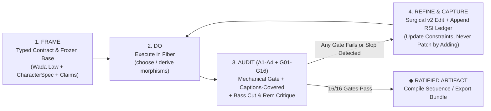

# META-PLAN & RECURSIVE SELF-IMPROVEMENT (RSI) PROTOCOL: Motion Atlas Studio Pro

**Document ID:** `CETI-MOTION-RSI-V1.0`  
**Contract Reference:** [`TYPED-CONTRACT-MOTION-ATLAS.md`](file://WORKSPACE/ARTE/motion-atlas/docs/TYPED-CONTRACT-MOTION-ATLAS.md)  
**Discipline:** `Brief → Typed Schema → Executed Instrument → 16-Gate Mechanical Audit → Adversarial Critique → Surgical v2 Refinement → Compounding Ledger`

---

## 1. The 16 Binary Conservation Gates (`G01`–`G16`)

No build or AI-enhanced storyboard branch is ratified until all 16 predicates evaluate to `PASS` via `node scripts/validate-motion-studio.mjs` and the live in-studio **Conservation Gate HUD**:

| Gate ID | Domain | Predicate (Computed, Never Estimated) | Failure Mode Caught |
|---|---|---|---|
| **`G01`** | **Wada Color Closure** | Every fill/stroke in every proof resolves through `prep(WadaHarmonicPalette)` or its OKLab `chordTable`. All 348 Sanzo Wada combinations (`geome-wada.js`) + 17 Atlas + 7 Hydrographic plates are addressable. | Arbitrary RGB/hex soup; off-palette colors. |
| **`G02`** | **WCAG Contrast & Role Pinning** | `roles.ink` on `roles.paper` $\ge 7.0:1$ on paper grounds (`atlas`, `ceti`, `tint`) and luminous edge $\ge 10.0:1$ on dark grounds (`deep-sea`, `hydro-ink`). Nearest CETI token $\Delta E_{2000}$ computed for every swatch. | Illegible low-contrast ink or copper-as-body-text error. |
| **`G03`** | **Parametric Character Independence** | Zero hardcoded character lock-in: `renderActor(ctx, P, charSpec, pose)` and `actorGeom(charSpec, pose)` drive $\ge 8$ distinct built-in character rigs (`ceti-whale`, `saul-falcon`, `lantern-bathysphere`, `origami-crane`, `astronav-compass`, `doodle-scribe`, `geome-orpheus`, `custom-actor`) across all proofs and storylines. | Whale-only hardcoding; inability to swap or invent characters. |
| **`G04`** | **Multi-Mode Character Interaction** | Every character supports all 8 `CharacterInteractionMode` grammars (`hero-journey`, `filter-engine`, `guide-pointer`, `retriever-carrier`, `continuous-morph`, `dialogue-duet`, `simulation-driver`, `hydrographic-trace`) and all 6 render modes (`wash`, `paper`, `line`, `flat`, `pixel`, `hydrographic`). | Static mascot pasted in a corner instead of acting in the world. |
| **`G05`** | **Saul Bass 5-Rung Reduction Ladder** | Every character/emblem carries a complete 5-rung `ReductionLadderSpec` (`Inventory → Pivot → Silhouette → Severance → The Cut`) plus live 16px, 1-color, knockout, and squint gauntlet tests. | Un-severed clipart silhouettes ("Stopping at Rung 3"). |
| **`G06`** | **Single Deterministic Clock (`frame = f(t)`)** | Every canvas proof, infinite-canvas node, and exported sequence is a pure function of $(t, P, F, C, \text{seed})$. Calling `window.seek(t)` twice returns byte-identical pixels. Zero `Math.random()` or `Date.now()` in render paths. | Non-reproducible drift; un-scrubbable animations. |
| **`G07`** | **Closed-Form Spring & Easing Law** | Includes all 7 canonical motion feels (`spring`, `glaser`, `rest`, `slow`, `held`, `beat`, `rostrum`) with closed-form evaluation of $t$ (no stateful frame-to-frame physics accumulation). | Stateful simulation that breaks when scrubbing backwards. |
| **`G08`** | **5-Lens Fork Explorer Parity+** | Preserves 100% of the `Motion Atlas Explorer` capabilities (`Look`, `Use`, `Story` lenses, 15 styles, 8+ storylines, 24 elements, Contact Sheet, Palette Matrix, Kept Brief) and extends to `Character` & `Register` lenses with embedded offline Atlas KB (`0` broken `/_blob/` fetches). | Regression against `Motion Atlas Explorer` or offline `dataErr`. |
| **`G09`** | **Infinite-Zoom Living Canvas & DAG Forks** | Interactive pan/zoom spatial canvas (`0.1x` to `8.0x` zoom, semantic LOD, minimap, auto-layout) where every node is a live-rendered canvas card, supports `⑂ Fork Branch` with `upstream_hash` tracking, and side-by-side `⚖ A/B Branch Comparison`. | Flat tab UI with no spatial mapping or branching story trees. |
| **`G10`** | **Sheaf Restriction Glue ($\rho$)** | On every DAG fork/handoff `parent → child`, frozen upstream fields satisfy $\rho(\text{child}) = \text{parent}$, and `choose` fibers only mutate permitted slots (`may_add`). | Downstream frames contradicting upstream brief/claims/direction. |
| **`G11`** | **Storyboard Predicates (`CoveredOk`, `MovementOk`, `OneBreather`)** | Every storyboard branch enforces: (a) `CoveredOk` (marks carry the claim when captions are hidden), (b) `MovementOk` ("this moves because..." $\in \{\text{attention}, \text{continuity}, \text{change}, \text{character}\}$), (c) `OneBreather` (exactly one hold/rest beat), and (d) `Callback` motif plant & return. | Slideshow transitions, decorative motion, or wall-to-wall rush without rest. |
| **`G12`** | **Kinetic Hydrography Survey Mode** | Dedicated survey-plate mode (`philosophy.md` + `motion-atlas-plates.pdf`) plotting any motion trajectory as $N \in \{12, 24, 48\}$ ghost positions with bearing rings (`000/090/180/270`), depth soundings, bimodal scale, $\ge 33\%$ open water, and Fraunces 300 italic cartouche. | Showing motion only as fleeting spectacle rather than chartable terrain. |
| **`G13`** | **Multi-Provider OAuth PKCE & Live AI Bridge** | Working OAuth 2.0 PKCE client flow (OpenRouter PKCE / Google OAuth GIS / Local CLI Loopback Bridge / Direct API Key + Offline Algebraic Synthesizer fallback) that enhances beats, forks 3 narrative branches, and synthesizes new `CharacterSpec` rigs via schema-validated JSON. | Dead/mock OAuth buttons or unvalidated free-text LLM output. |
| **`G14`** | **Multi-Target Animation Compiler & Exporter** | Compiles any committed DAG branch into: (1) Standalone playable single-clock HTML/SVG sequence (`window.seek(t)`), (2) High-bitrate WebM/MP4 video stream + 900-DPI PNG keyframe contact sheet, (3) Executable code scaffold (`HyperFrames` / `anime.js v4` / `Remotion`), and (4) Stage-1 Motion Brief. | Storyboard tool that cannot compile into an actual animation artifact. |
| **`G15`** | **Zero-Bloat Persistence Vault** | IndexedDB autosave + portable `.motion.studio.json` and `.motion.studio.json.gz` (`CompressionStream('gzip')`) preserving the full DAG fork tree, custom characters, and Wada pins in `< 150 KB`. | LocalStorage quota overflow or lost work on reload. |
| **`G16`** | **Accessibility & Reduced-Motion Contract** | `prefers-reduced-motion: reduce` defaults to paused resolution frame with explicit transport controls; captions-covered toggle verifies visual self-sufficiency; keyboard shortcuts for every canvas and timeline operation. | Motion-gated information or inaccessible controls. |

---

## 2. Phased Work Units & Execution Plan (`U1`–`U8`)

We execute in strict dependency order, verifying each unit before advancing:

- **`U1 · Wada 348-Combination & OKLab Harmonic Engine (`wada-harmonic-engine.js`)`**
  - Ingests `geome-wada.js` (all 348 Sanzo Wada combinations) + the 17 curated Atlas plates + the 7 Kinetic Hydrography plates (`Nos. 296, 279, 166, 243, 339, 84, 207`).
  - Computes perceptual OKLab coordinates, $N \times N$ closed chord tables, $\Delta E_{2000}$ nearest CETI token mappings (`--mk-copper`, `--mk-sage`, `--mk-peach`, `--mk-slate`, `--mk-rust`, `--mk-paper`, `--mk-deep-sea`), and automatic `roles.ink` / `roles.paper` contrast pinning ($\ge 7.0:1$).
- **`U2 · Parametric Multi-Character & Emblem Rig Engine (`character-rig-engine.js`)`**
  - Replaces hardcoded `whaleGeom`/`whale` with universal `actorGeom(charSpec, pose)` and `renderActor(ctx, P, charSpec, pose)`.
  - Ships 8 complete, deeply-crafted `CharacterSpec` archetypes (`ceti-whale`, `saul-falcon`, `lantern-bathysphere`, `origami-crane`, `astronav-compass`, `doodle-scribe`, `geome-orpheus`, `custom-actor`), each with its 5-Rung Reduction Ladder, 6 render modes (`wash`, `paper`, `line`, `flat`, `pixel`, `hydrographic`), and 8 interaction modes.
- **`U3 · Self-Contained Atlas Knowledge Base & Proof Renderer (`motion-atlas-engine.js`)`**
  - Embeds the complete 171-node Atlas knowledge base (`styles`, `elements`, `engines`, `laws`, `gates`, `pitfalls`, `sources`, `stages`, `ideas`) directly on disk so `DATA_URL` never fails offline.
  - Upgrades all 15 style proofs (`watercolor`, `cutout`, `doodle`, `pixel`, `voxel`, `orbit`, `morph`, `kinetic`, `hybrid`, `editorial`, `whiteboard`, `sim`, `overlay`, `hydrographic`, `saul-severe`), 8 storylines, and 24 element demos to dynamically star **whichever `CharacterSpec` and `CharacterInteractionMode` is active**.
- **`U4 · Infinite-Zoom Living Canvas & DAG Storyboard Engine (`infinite-canvas-engine.js`)`**
  - Builds the hardware-accelerated pan/zoom spatial pasteboard (`0.1x`–`8.0x`), semantic zoom LOD, curved cubic-bezier DAG wires with restriction status badges ($\rho$ verified), live 60fps canvas nodes, `⑂ Fork Branch`, `⚖ A/B Compare`, captions-covered test toggle, and 8-panel storyboard sheet editor.
- **`U5 · OAuth 2.0 PKCE Live Enhancer & Local Loopback Bridge (`oauth-enhancer.js` + `scripts/oauth-bridge-server.mjs`)`**
  - Implements browser OAuth 2.0 PKCE (`S256` challenge/verifier for OpenRouter & Google OAuth GIS), local CLI loopback bridge (`http://127.0.0.1:8787`), direct API key vault, and deterministic algebraic fallback.
  - Exposes 4 typed live-canvas actions: `✦ Enhance Storyboard Beats`, `✦ Fork 3 Narrative Branches`, `✦ Synthesize New Character Rig`, and `✦ Run RSI Gate & Critique`.
- **`U6 · Animation Compiler & Archival Exporter (`compiler-exporter.js`)`**
  - Compiles any selected DAG branch or storyline into:
    1. Standalone single-file playable HTML5/SVG animation (`window.seek(t)` + transport bar),
    2. Real-time `MediaRecorder` WebM/MP4 high-bitrate video capture + 900-DPI PNG keyframe contact sheet,
    3. Executable `HyperFrames` / `anime.js v4` / `Remotion` code bundle,
    4. Portable `.motion.studio.json.gz` session archive.
- **`U7 · Unified Flagship Studio Surface (`ARTE/motion-atlas/Motion Atlas Studio Pro.dc.html` & `index.html`)`**
  - Integrates all 7 studio surfaces (`Infinite Canvas`, `5-Lens Fork Explorer`, `Character & Emblem Foundry`, `Storyboard & Beats Room`, `Wada 348 + Chord Matrix`, `Contact Sheet`, `Compile & Export`) with dual CETI theme support (`Atlas/CETI Cream Paper` $\leftrightarrow$ `Bathysphere/Hydrographic Deep-Sea Dark`).
- **`U8 · Recursive Self-Improvement (RSI) Loop & Mechanical Verification (`scripts/validate-motion-studio.mjs`)`**
  - Runs the 16-gate verifier, executes an adversarial critique pass (`what-would-bass-cut.md` + `rem-co-expression-audit.md`), applies surgical v2 refinements, and records durable findings in `docs/RSI-LEDGER.md`.

---

## 3. Recursive Self-Improvement (RSI) Loop Specification

Every iteration of the studio (and every storyboard built *inside* the studio) runs a 4-stage closed RSI loop:

### RSI Adversarial Lenses (Built into Both the Build Process and the Studio's Live Inspector)
1. **Lens A1 (`Saul Bass Reduction & Severance Audit`)**:
   - *Question:* "What is still in the frame that doesn't have to be? Does one severed shape carry the meaning at 16px?"
   - *Action:* Deletes secondary decorative emblems, enforces dominant ink field (`55–75%`), and verifies Rung 4 severance.
2. **Lens A2 (`Rem Koolhaas Programme & Co-Expression Audit`)**:
   - *Question:* "What is this sequence actually doing over time versus what its adjectives claim? Is the breather void drawn as deliberately as the active beats?"
   - *Action:* Enforces `OneBreather`, `Callback` motif identity, and two-register typography (Declaration vs. Argument).
3. **Lens A3 (`Kinetic Hydrography & Wada Chromatic Audit`)**:
   - *Question:* "Are all colors closed over the active Sanzo Wada combination? Does ink clear 7:1 on paper? Can the motion be read as a static hydrographic ghost-trail?"
   - *Action:* Verifies `G01`–`G02` contrast and renders the hydrographic ghost-position overlay to expose uneven easing or dead freezes.
4. **Lens A4 (`HyperFrames Sheaf Restriction & Captions-Covered Audit`)**:
   - *Question:* "If we hide all captions (`Captions-Covered Mode`), do the character and stage marks alone prove the beat's `coveredSentence`?"
   - *Action:* Enforces `CoveredOk`, `MovementOk`, and $\rho(\text{shots}) = \text{storyboard}$.
